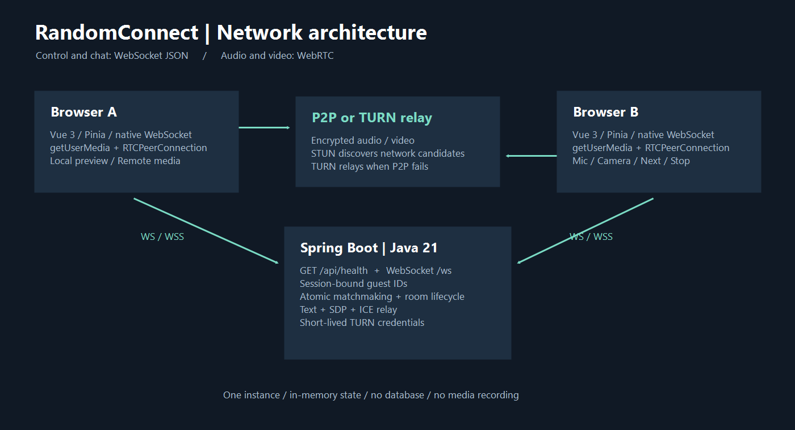

# RandomConnect — Lập trình mạng

Ứng dụng ghép cặp guest ngẫu nhiên, chat chữ thời gian thực và video/audio WebRTC 1–1. Vue 3 + Vite + Pinia + Vue Router; Java 21 + Spring Boot 3.5.16 + native WebSocket. Không dùng database, tài khoản hoặc lưu lịch sử.

## Thông tin nhóm (03 thành viên)

| Thành viên | Họ tên / MSSV / Email | Trách nhiệm |
|---|---|---|
| 1 | TODO / TODO / TODO | Backend, queue/room, relay và concurrency |
| 2 | TODO / TODO / TODO | Frontend, chat, trạng thái và UX |
| 3 | TODO / TODO / TODO | WebRTC, TURN và tích hợp |

**Ghi chú mẫu giảng viên:** thư mục ban đầu trống, chưa có Git repository, `INSTRUCTION.md` hay README mẫu. Các thư mục được tạo theo đặc tả; chưa thể xác nhận bố cục khớp mẫu giảng viên. Không tạo hoặc sửa `INSTRUCTION.md`. Nhóm cần bổ sung thông tin thật và lịch sử đóng góp thật.

## Kiến trúc và chức năng



- Server cấp guest ID cho từng WebSocket. Ghép hai người đang chờ; một guest chỉ thuộc một queue hoặc một room.
- Chat chữ có kiểm tra room, trim, tối đa 2000 ký tự; server gán senderId, messageId và timestamp, echo đúng một lần tới mỗi thành viên.
- Video/audio qua RTCPeerConnection; offer/answer và ICE đi qua WebSocket, media đi P2P hoặc TURN.
- Preview chỉ sau thao tác cho phép, mute/camera bằng `track.enabled`. Next giữ local preview, đóng peer cũ. Stop/ngắt kết nối/rời trang giải phóng media.
- Next chỉ đưa người yêu cầu vào queue; đối tác về Idle. Stop không ghép lại. Có heartbeat và origin allowlist.
- Có lựa chọn chủ động chỉ chat chữ; lựa chọn này không gửi camera/mic của bạn. Bạn vẫn có thể nhận media nếu đối tác đã chọn video.

## Yêu cầu môi trường

JDK **21**, Node.js **22.12+**, npm. Lần đầu cần Internet để Maven Wrapper và npm tải dependency. Cài JDK 21 và đặt `JAVA_HOME` tới JDK này; máy hiện tại đã có cả JDK 21 và 24 nên cần chọn đúng.

## Chạy trên Windows (hai terminal)

Terminal 1, từ thư mục dự án:

```powershell
$env:JAVA_HOME = 'C:\Program Files\Java\jdk-21'
cd source/server
.\mvnw.cmd spring-boot:run
```

Terminal 2:

```powershell
cd source/client
npm ci
npm run dev
```

Mở **http://localhost:5173**, backend mặc định **http://localhost:8081**.

Backend mặc định dùng **8081**; frontend REST và WebSocket cũng trỏ tới 8081. Không cần đặt biến `PORT`. Có thể ghi đè cổng bằng biến này khi cần.

```powershell
Invoke-RestMethod http://localhost:8081/api/health
```

macOS/Linux: đặt `JAVA_HOME` tới JDK 21; trong `source/server` chạy `sh ./mvnw spring-boot:run` (hoặc cấp quyền executable rồi `./mvnw`). Frontend dùng cùng lệnh npm.

## Cấu hình

Frontend mặc định kết nối localhost. Muốn thay đổi, chép `source/client/.env.example` thành `.env.local` và khởi động lại Vite. Các biến `VITE_` là cấu hình công khai trong bundle, tuyệt đối không chứa shared secret.

Backend đọc biến môi trường của tiến trình; **không tự đọc `.env`**. Xem `source/server/.env.example`. Mặc định origin cho phép `http://localhost:5173` và `http://127.0.0.1:5173`. Thay đổi `ALLOWED_ORIGINS` khi đổi URL.

TURN tùy chọn: đặt `TURN_URLS` và `TURN_SHARED_SECRET` ở backend, dùng cùng secret với Coturn. Backend cấp username/password HMAC có hạn 10 phút qua WebSocket và cấp lại khi ghép room; shared secret không ra client. Xem [triển khai HTTPS/TURN](docs/DEPLOYMENT.md).

## Kiểm thử và demo

```powershell
cd source/server
.\mvnw.cmd test
.\mvnw.cmd package
```

```powershell
cd source/client
npm test
npm run build
npm audit
```

Mở A/B ở hai tab hoặc profile độc lập. Cấp quyền media bằng nút rõ ràng, Start A → Waiting, Start B → cùng room. Gửi tin hai chiều, kiểm tra âm thanh/video và nút Mic/Camera. A Next → B Partner left; mở C và Start → A/C ghép, B ở Idle. Stop, refresh hoặc đóng C và kiểm tra cleanup. Hướng dẫn đầy đủ và kết quả thực tế: [TESTING.md](docs/TESTING.md).

## Giao thức và tài liệu

REST `GET /api/health`; native WebSocket `/ws` với envelope `{type, requestId?, roomId?, payload?}`. Các event chính: SESSION_READY, FIND_PARTNER, WAITING, MATCH_FOUND, CHAT_MESSAGE, WEBRTC_OFFER, WEBRTC_ANSWER, ICE_CANDIDATE, NEXT_PARTNER, LEAVE_ROOM, PARTNER_LEFT, ROOM_CLOSED, ERROR, PING/PONG.

- [Kiến trúc và đồng bộ](docs/ARCHITECTURE.md)
- [Protocol và giới hạn](docs/PROTOCOL.md)
- [Kết quả test / checklist manual E2E](docs/TESTING.md)
- [HTTPS / NAT / TURN](docs/DEPLOYMENT.md)
- [Báo cáo các phase và file](docs/IMPLEMENTATION_REPORT.md)
- [Client README](source/client/README.md), [Server README](source/server/README.md)

## Giới hạn và kết quả

MVP dùng một server instance với state trong RAM; restart mất toàn bộ phiên, chưa hỗ trợ scale ngang. Chat chỉ nằm trong bộ nhớ phiên trên client và bị xóa khi đổi room. Không ghi âm/ghi hình.

Build và các test tự động đã chạy; xem số liệu trong TESTING.md. **Chưa xác minh camera/microphone/video/audio E2E trên hai browser/thiết bị**. Công cụ UI đã dừng vì không xác định được URL hiện tại của Chrome; không có screenshot hay kết quả media giả. STUN-only không đảm bảo qua mọi NAT. HTTPS/WSS và TURN cần cấu hình thực để thử hai mạng khác nhau.

Đây là demo nội bộ dành cho người tham gia đồng ý. Trước khi mở công khai cần moderation, kiểm soát lạm dụng và giới hạn tài nguyên theo IP/toàn hệ thống. Docker và tính năng ngoài MVP chưa thêm.
