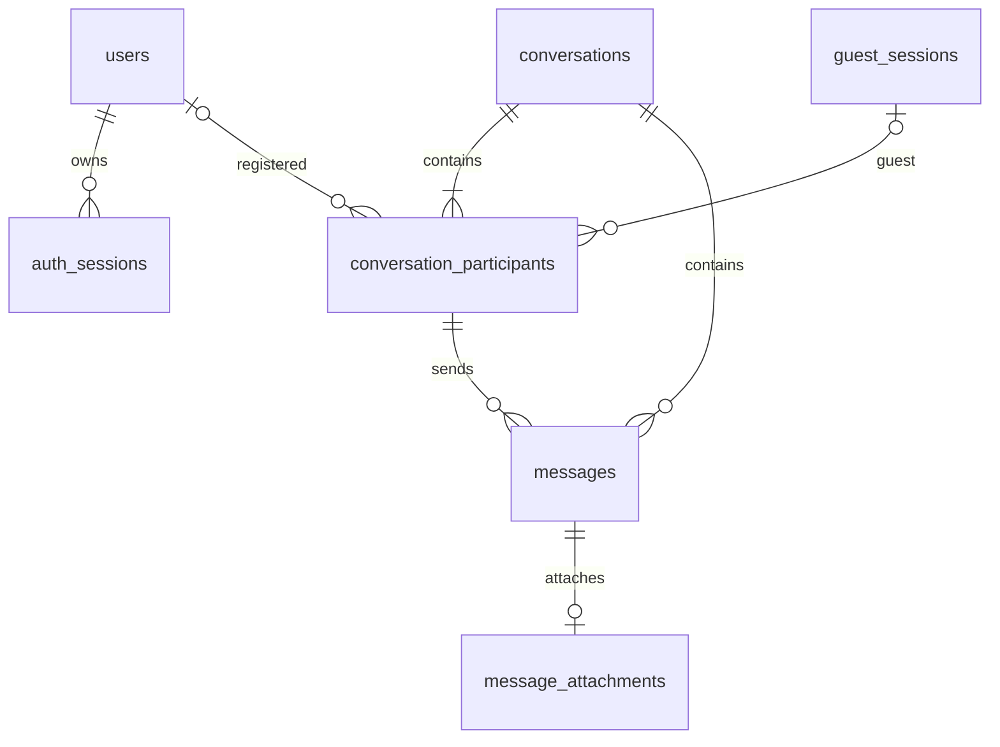

# Database RandomConnect

MySQL 8+ trên Aiven; JPA chỉ `validate`, Flyway áp dụng migration V1 trong `source/server/src/main/resources/db/migration`. UUID dạng VARCHAR(36), timestamp UTC độ chính xác microsecond. Không tự baseline database có sẵn, không chạy clean/drop. V1 được Flyway ghi nhận một lần; lần khởi động sau kiểm tra checksum rồi bỏ qua migration đã chạy. Không sửa V1 sau khi triển khai; tạo V2.

| Bảng | Vai trò và ràng buộc |
|---|---|
| users | username/email unique đã chuẩn hóa lowercase; BCrypt; display_name, avatar_url, role/status, created/updated/last_login |
| guest_sessions | SHA-256 token ngẫu nhiên; expiry, last_active_at, status |
| conversations | UUID trùng roomId; ACTIVE/CLOSED; persistent_history; expires_at cho hội thoại tạm |
| conversation_participants | FK conversation/user/guest; CHECK đúng một user_id hoặc guest_session_id; unique theo conversation và định danh; hidden_at cho từng người |
| messages | FK conversation và composite FK conversation/sender để ngăn sender thuộc phòng khác; client_message_id UUID chống retry trùng; TEXT/IMAGE/FILE/AUDIO; status SENT/DELIVERED/READ |
| message_attachments | FK message unique; storage_key unique; tên/MIME/dung lượng/loại/thời lượng; không chứa binary hoặc URL công khai |
| auth_sessions | FK user; chỉ lưu hash refresh, expiry, rotated_at, revoked_at |

Các entity có ID và created_at chung. SYSTEM được schema cho phép nhưng hiện chưa có chức năng sinh system message. Tin nhắn chưa hỗ trợ sửa/xóa riêng dù schema dự phòng edited_at/deleted_at. Quan hệ dùng scalar ID trong Java và FK trong SQL để kiểm soát DTO, tránh serialize entity hoặc N+1 tự động. Danh sách participants/users/attachments được truy vấn theo lô. Lịch sử và tin nhắn phân trang tối đa 50 phần tử; tin nhắn theo created_at DESC, id DESC. Index tra thành viên, lịch sử, message paging và expiry nằm trong V1.

Matching tạo conversation + participants trong transaction; lưu message + attachment cùng transaction. State lock hiện tại đảm bảo một định danh không ở hai room/queue và không ghi vào room đã Next. Object Storage nằm ngoài transaction DB: upload trước, kiểm tra lại room rồi commit; nếu room đã đóng hoặc ghi thất bại, xóa object bù. Khi process chết đúng giữa upload và commit có thể còn orphan; xem tài liệu storage.

Dọn theo lô mỗi 60 giây: hội thoại tạm hết TTL, hội thoại tài khoản CLOSED đã được cả hai ẩn, auth session hết hạn, guest hết hạn không còn participant. Xóa object trước rồi attachment/message/participant/conversation. Storage lỗi thì giữ metadata để retry. Với TTL, quyền đọc bị từ chối ngay thời điểm hết hạn dù cleanup vật lý bị chậm.

Khởi động: Hikari kết nối thật, Flyway migration, Hibernate validate; sai credential/TLS/schema sẽ không khởi động. `/api/health` kiểm tra connection còn hợp lệ, trả 503 nếu DB không sẵn sàng. Pool tối đa 3. Test tự động dùng H2 MySQL mode; đã kiểm tra kết nối TLS với Aiven thật; log startup local người dùng cung cấp ngày2026-11-07 xác nhận V1 áp dụng thành công trên MySQL8.4. Các tests tự động vẫn dùng H2. Cần backup + kiểm tra schema hiện hữu và chạy trên database staging trước production.
