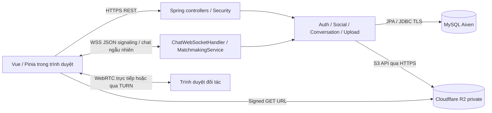
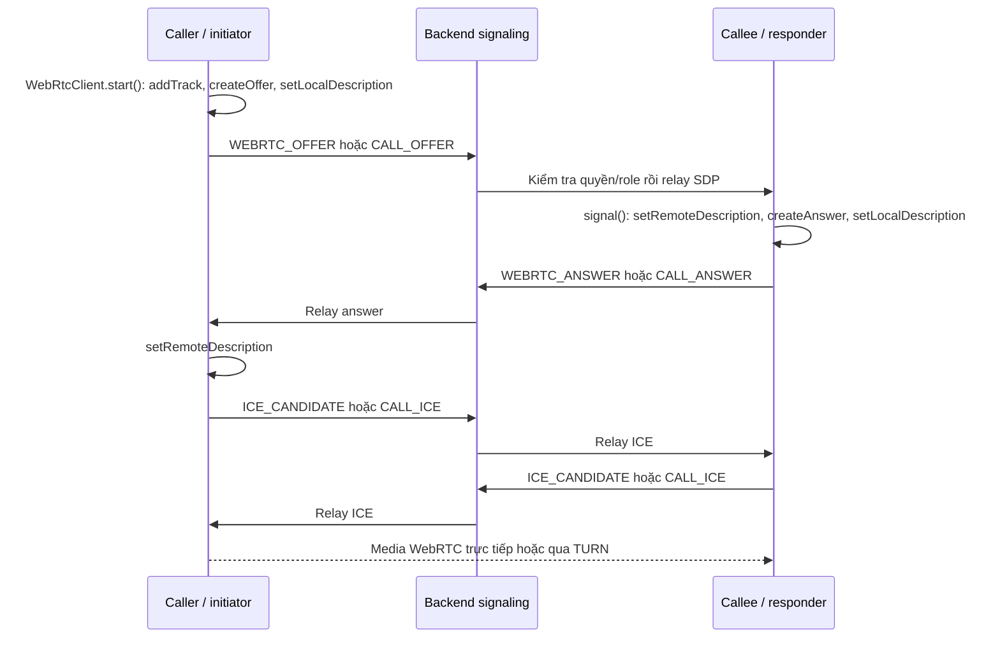

# RandomConnect: toàn bộ luồng chức năng, hàm và biến

Ngày đối chiếu mã: **10/11/2026**. Tài liệu mô tả code trong workspace tại thời điểm viết; bản Render/Vercel chỉ có hành vi này sau khi được deploy cùng phiên bản.

Không chứa mật khẩu, token, nội dung `.env` thật hoặc truststore. Các giá trị cấu hình bên dưới là mặc định trong code hoặc ví dụ.

## Mục lục

1. [Bản đồ hệ thống và cách đọc](#1-bản-đồ-hệ-thống-và-cách-đọc)
2. [Khởi động backend, frontend và health](#2-khởi-động-backend-frontend-và-health)
3. [Xác thực REST và CSRF](#3-xác-thực-rest-và-csrf)
4. [Đăng ký, đăng nhập, khách và khôi phục phiên](#4-đăng-ký-đăng-nhập-khách-và-khôi-phục-phiên)
5. [Đăng xuất và hồ sơ](#5-đăng-xuất-và-hồ-sơ)
6. [Kết nối WebSocket](#6-kết-nối-websocket)
7. [Ghép người lạ, Next, Stop và reconnect](#7-ghép-người-lạ-next-stop-và-reconnect)
8. [Chat chữ ngẫu nhiên và receipt](#8-chat-chữ-ngẫu-nhiên-và-receipt)
9. [Camera, mic, WebRTC, STUN và TURN](#9-camera-mic-webrtc-stun-và-turn)
10. [Tìm người và kết bạn](#10-tìm-người-và-kết-bạn)
11. [Chat riêng và polling](#11-chat-riêng-và-polling)
12. [Gọi video trực tiếp](#12-gọi-video-trực-tiếp)
13. [Gửi file](#13-gửi-file)
14. [Ghi âm và gửi tin nhắn thoại](#14-ghi-âm-và-gửi-tin-nhắn-thoại)
15. [Tải file và phát ghi âm](#15-tải-file-và-phát-ghi-âm)
16. [Lịch sử, ẩn và cleanup](#16-lịch-sử-ẩn-và-cleanup)
17. [Từ điển biến runtime](#17-từ-điển-biến-runtime)
18. [DTO, database và repository](#18-dto-database-và-repository)
19. [Toàn bộ biến cấu hình](#19-toàn-bộ-biến-cấu-hình)
20. [API, sự kiện, lỗi và giới hạn](#20-api-sự-kiện-lỗi-và-giới-hạn)
21. [Cách lần code và đặt breakpoint](#21-cách-lần-code-và-đặt-breakpoint)
22. [Chỉ mục file, hàm và số dòng](#22-chỉ-mục-file-hàm-và-số-dòng)

## 1. Bản đồ hệ thống và cách đọc

Quy ước đường dẫn:

- `FE/` = `source/client/src/`.
- `BE/` = `source/server/src/main/java/com/randomconnect/`.
- `RES/` = `source/server/src/main/resources/`.
- `A → B` nghĩa là A gọi B hoặc phát sự kiện mà B xử lý; đoạn đi qua mạng được đánh dấu HTTP/WS.
- Hàm Vue ở mỗi component là hàm riêng dù cùng tên `send`, `load`, `cancel`.
- Phần 22 có link file và số dòng để mở đúng nơi định nghĩa. Số dòng có thể đổi khi chỉnh code.



| Chức năng | Đường truyền | Có lưu DB? | Có lưu binary R2? |
|---|---|---|---|
| Đăng nhập, hồ sơ, bạn bè | REST | Có | Không |
| Chat chữ ngẫu nhiên | WebSocket | Có, theo retention | Không |
| Chat chữ riêng | POST REST; nhận bằng GET polling | Có | Không |
| File và tin nhắn thoại | POST multipart REST; nhận metadata bằng WS/polling | Có | Có |
| Video/audio cuộc gọi | Signaling WS; media WebRTC | Không lưu media | Không |

Render là backend ứng dụng, không tự trở thành TURN server. R2 là kho object, không phải máy chủ cuộc gọi. Không dùng FTP.

## 2. Khởi động backend, frontend và health

### 2.1 Backend

```text
Docker ENTRYPOINT docker-entrypoint.sh (nếu chạy Docker)
  → đọc DB_TRUSTSTORE_BASE64_PATH nếu có
  → base64 -d → file PKCS12 trong /tmp → export DB_TRUSTSTORE_URL
  → java -jar /app/app.jar
  → RandomConnectApplication.main()
  → SpringApplication.run()
  → tạo bean cấu hình, DataSource/Hikari, Flyway, JPA, Security, WS, Storage
  → StartupRecovery.run()
  → RetentionService.reconcile()
```

Thứ tự tạo bean chi tiết do Spring và phụ thuộc bean quyết định; sơ đồ trên là các giai đoạn, không phải mọi bean chạy tuần tự theo tên.

| File/hàm | Vai trò |
|---|---|
| `BE/RandomConnectApplication.main()` | Điểm vào Java; `@EnableScheduling` bật job định kỳ |
| `RES/application.yml` | Import `.env` theo working directory; datasource, TTL, auth, multipart |
| `RES/application-render.yml` | Profile render: bind 0.0.0.0, PORT, exact origin, Secure cookie |
| `BE/config/DatabasePolicy` constructor | Ngoài test: kiểm tra hostname, DB_PASSWORD, VERIFY_IDENTITY |
| Flyway | Áp dụng V1, V2 nếu chưa có; validate checksum; không tự xóa schema |
| JPA `ddl-auto=validate` | Kiểm tra entity khớp schema, không tự tạo bảng thay migration |
| `BE/config/SecurityConfig` | Tạo JWT key/encoder/decoder, BCrypt, filter chain |
| `BE/storage/StorageConfig.storage()` | Chọn disabled hoặc S3-compatible |
| `BE/config/StartupRecovery.run()` | Đóng RANDOM ACTIVE còn sót sau restart; bỏ qua DIRECT |

`spring-boot:run` local không chạy shell entrypoint. Truststore Windows không dùng được trên Render; dùng Secret File + đường dẫn Linux hoặc cơ chế base64.

### 2.2 Frontend

```text
index.html → FE/main.js
  → createApp(App).use(createPinia()).use(router).mount('#app')
  → router.beforeEach() → auth.restore()
  → RouterView chọn HomeView / FriendsView / HistoryView / ProfileView
  → App.vue watch auth.user.id → callStore.disconnect()/connect(id)
```

`router/index.js` có `/`, `/friends`, `/history`, `/profile`. Ba route sau có `meta.user=true`: cần user đã khôi phục/đăng nhập, guest bị chuyển về `/`.

`App.vue` giữ `DirectCallPanel` ở cấp ứng dụng: đổi route không hủy cuộc gọi riêng. `pagehide → leave() → calls.disconnect()`; `pageshow → resume() → calls.connect()` nếu còn user. Ngược lại, rời Home hủy phiên ghép ngẫu nhiên qua `HomeView.onBeforeUnmount()`.

### 2.3 Health

```text
HomeView.checkHealth()
  → api.js health() → GET /api/health (timeout 5 giây)
  → HealthController.health()
  → DataSource.getConnection() → connection.isValid(2)
  → 200 {status:UP} hoặc 503 {status:DOWN}
  → HomeView.status → nút Server sẵn sàng/chưa khả dụng
```

Health chỉ kiểm tra database; không chứng minh R2, ffprobe, TURN hoặc camera hoạt động.

## 3. Xác thực REST và CSRF

Mọi request qua `FE/services/api.js` dùng Axios instance `api`:

```text
api.get/post/patch/delete(...)
  → request interceptor
    ├─ URL /api/auth/* + phương thức unsafe → csrf() → GET /api/auth/csrf
    │   → lấy token/headerName → đặt header CSRF; trình duyệt gửi cookie
    └─ URL khác → credentials.authorization() → Authorization: Bearer ... hoặc Guest ...
  → HTTP → SecurityConfig.security() filter chain
    ├─ GuestAuthenticationFilter.doFilterInternal() → IdentityService.guestToken()
    └─ Bearer JWT decoder → kiểm tra HS256/issuer/exp → IdentityService.validate(actor)
  → @AuthenticationPrincipal Actor trong controller
```

`SecurityConfig` stateless; chỉ public `/api/health`, `/api/auth/**`, `/ws`, `/error`. Public `/ws` vẫn phải qua origin và `IdentityHandshake`. CSRF áp dụng unsafe request `/api/auth/*`; API dùng header token khác không dùng refresh cookie để xác định principal.

`CookieCsrfTokenRepository` đặt cookie CSRF HttpOnly, path `/api/auth`; JS nhận token qua JSON từ `AuthController.csrf()`. Refresh cookie tên `rc_refresh`, cũng HttpOnly, path `/api/auth`. Axios `withCredentials=true` cho phép gửi cookie theo chính sách trình duyệt.

`csrfPromise` cache request lấy CSRF trong tab; `refreshPromise` gộp refresh đang chạy. `apiError(error)` chọn `response.data.message` hoặc lỗi mạng chung.

## 4. Đăng ký, đăng nhập, khách và khôi phục phiên

### 4.1 Đăng ký

```text
AuthPanel.submit() [mode=register]
  → authStore.authenticate('register', body)
  → api.post('/api/auth/register', body) + CSRF
  → AuthController.register(@Valid Register)
  → limit(request) → RequestLimits.take('auth:'+IP, 40/phút)
  → AuthService.register(username,email,password,display)
    → trim/lowercase username và email
    → kiểm tra username, password tối đa 72 byte UTF-8, duplicate
    → passwords.encode() [BCrypt cost 12]
    → UserRepository.saveAndFlush(UserAccount)
    → createSession(user) → AuthSessionRepository.save(session)
    → grant(user,session,refreshToken) → JwtEncoder.encode()
  → AuthController.respond() → Set-Cookie rc_refresh + JSON accessToken,user,expiresIn
  → clearCredentials() → accessToken/currentUser cập nhật
  → HomeView watch → session.connect(); App watch → calls.connect()
```

`Register` yêu cầu username 3–32 chữ/số/underscore, email đúng định dạng ≤254, password 8–72 ký tự; service còn giới hạn 72 byte cho BCrypt; displayName ≤80. `UserView` không trả password hash. `createSession()` tạo hạn 30 ngày; token có dạng `sessionId.randomSecret`, chỉ SHA-256 hash được lưu DB. `grant()` ký JWT issuer `randomconnect`, subject=user ID, claim `sid`, `role`, `iat`, `exp`.

### 4.2 Đăng nhập

```text
AuthPanel.submit() [mode=login]
  → authStore.authenticate('login',{login,password})
  → AuthController.login() → AuthService.login()
  → UserRepository.findByUsernameOrEmail(lowercase login)
  → passwords.matches(password,passwordHash) + user.status == ACTIVE
  → lastLoginAt=now → createSession() → grant() → respond()
```

Mỗi lần login tạo auth session mới; chưa có UI quản lý tất cả thiết bị.

### 4.3 Khách

```text
AuthPanel.guest() → authStore.guest()
  → POST /api/auth/guest + CSRF → AuthController.guest()
  → IdentityService.createGuest()
  → Secrets.token() [32 byte random] → Secrets.hash(token)
  → GuestRepository.save(GuestIdentity, expiry mặc định 24 giờ)
  → {token,guestId,expiresAt} → clearCredentials() → guestToken=token
```

Guest có token riêng trong RAM, không có refresh cookie cho guest, không có quyền profile/history/friends/DIRECT. Reload mất guest token; không tự liên kết guest với tài khoản mới.

### 4.4 Khôi phục và refresh

```text
router.beforeEach() / HomeView.onMounted()
  → authStore.restore() [gộp bằng restoring]
  → refreshAccess() → POST /api/auth/refresh + CSRF + rc_refresh cookie
  → AuthController.refresh() → AuthService.refresh(raw)
  → sessionId(raw) → AuthSessionRepository.locked(id)
  → kiểm tra revokedAt/expiresAt/hash/user.status
  → đổi refreshTokenHash, rotatedAt → grant() → cookie mới + access JWT mới
```

Trong request thông thường: `401` + đang có accessToken + chưa `_retried` → response interceptor gọi `refreshAccess()` → `api(request)` lại một lần. Refresh thất bại → `clearCredentials()`.

Reuse refresh cũ → revoke session → publish `SessionRevoked` → đóng sockets. `noRollbackFor=ResponseStatusException` giữ quyết định revoke khi trả 401. Refresh không gia hạn mốc expiry 30 ngày. Single-flight chỉ trong từng tab; hai tab refresh đồng thời vẫn có thể gây reuse/revoke.

## 5. Đăng xuất và hồ sơ

### 5.1 Logout

```text
HomeView.signOut() → session.stop()
  → authStore.logout() → POST /api/auth/logout + CSRF/cookie
  → AuthController.logout() → AuthService.logout(raw)
  → sessions.locked() → so hash → revokedAt=now
  → publish SessionRevoked(sessionId)
  → MatchmakingService.revoked() → disconnect(socket) → đóng random room/direct call
  → AuthController xóa rc_refresh cookie
  → clearCredentials() → App watch calls.disconnect()
```

Nếu request logout lỗi, authStore không xóa danh tính local để tránh báo logout thành công khi server chưa revoke. `HomeView` đã dừng random session trước request.

### 5.2 Hồ sơ

```text
ProfileView.save()
  → authStore.update(displayName)
  → PATCH /api/users/me → UserController.update(@Valid Update)
  → AuthService.update(actor,displayName)
  → kiểm tra user → users.findById() → displayName.trim(),updatedAt
  → transaction commit → UserView → currentUser=data → saved=true
```

`GET /api/users/me → UserController.me() → AuthService.me()` lấy hồ sơ. Hiện UI chỉ sửa displayName, không sửa email/avatar/password.

## 6. Kết nối WebSocket

### 6.1 Lấy vé và handshake

```text
sessionStore.connect() hoặc callStore.connect(userId)
  → POST /api/socket-ticket + Authorization
  → SocketTicketController.ticket() → SocketTickets.issue(actor)
  → IdentityService.validate() → token random, tickets[SHA256(token)]={actor,until:now+30s}
  → frontend thêm ?ticket=... vào VITE_WS_URL
  → new SocketClient(...).connect() → new WebSocket(url)
  → WebSocketConfig.registerWebSocketHandlers('/ws') + exact Origin
  → IdentityHandshake.beforeHandshake()
  → RequestLimits.take('ws:'+remoteIP,60/phút)
  → SocketTickets.consume(ticket) [remove một lần + validate actor]
  → attrs['actor']=actor
  → ChatWebSocketHandler.afterConnectionEstablished(socket)
  → MatchmakingService.open(socket)
  → GuestSession + ConcurrentWebSocketSessionDecorator
  → emit SESSION_READY → outbox → flush() → MessageSender.send()
```

`IdentityHandshake` còn fallback client không có ticket: tạo guest DB mới. Ticket sai/hết hạn không fallback. Query ticket là credential ngắn hạn, không ghi vào log công khai.

Một user ở Home có thể có **hai socket**: random session do Home quản lý và call presence do App quản lý. Không dùng socket random để suy ra mọi user có thể nhận direct call.

### 6.2 Nhận và gửi envelope

```text
SocketClient.send(type,roomId,payload)
  → JSON.stringify({type,requestId,roomId?,payload}) → WebSocket.send()
  → ChatWebSocketHandler.handleTextMessage()
  → ObjectMapper.readValue(...,SocketMessage.class)
  → kiểm tra size/type/requestId/roomId → MatchmakingService.accept(socketId,message)
  → validate actor → lastSeen=now → GuestSession.allow()
  → CALL_* chuyển DirectCalls.accept(); event khác vào switch random
```

Chiều về: `emit()/relay() → outbox → flush() → MessageSender.send() → socket.sendMessage(TextMessage(JSON)) → SocketClient.onmessage → JSON.parse → onMessage=dispatch`.

### 6.3 Heartbeat

`SocketClient.connect().onopen` đặt interval 15 giây: gửi PING; backend trả PONG. Nếu client không nhận message >45 giây, lần tick kế tiếp đóng socket (thực tế khoảng 45–60 giây). Backend `expire()` chạy mỗi 5 giây, đóng socket nếu `now-lastSeen>SESSION_TIMEOUT_MS`. Mọi message hợp lệ đi vào accept đều cập nhật lastSeen.

## 7. Ghép người lạ, Next, Stop và reconnect

### 7.1 Start

```text
HomeView nút Start → sessionStore.start()
  → chặn busy/đã có room/WAITING/socket chưa OPEN
  → action++ → busy=true → media.enable() [bắt buộc camera/mic ở UI hiện tại]
  → getIceServers(serverIceServers)
  → SocketClient.send('FIND_PARTNER')
  → MatchmakingService.accept() → find(g,requestId)
```

`find()` kiểm tra directCalls.busy(actor), room/queue của socket khác cùng định danh; dọn waiting lỗi. Không có người chờ → thêm `g.id` vào waiting và emit WAITING. Có người → chọn ngẫu nhiên một candidate:

```text
RoomService.create(waitingPeer,g) → ChatRoom UUID, hai session.roomId
  → ConversationService.create(roomId,first.actor,second.actor)
  → conversations.saveAndFlush() + 2 participants
  → emit MATCH_FOUND cho hai bên
  → sessionStore.dispatch(MATCH_FOUND)
  → resetRoom() → ghi roomId/partnerId/policy → rtc.start(...)
```

Peer đã chờ là `initiator=true`, peer đến sau là false. Cả hai user → persistentHistory=true; có guest → expiresAt mặc định 24 giờ. Nếu tạo DB lỗi, remove room mới, trả waiting peer vào queue, gửi INTERNAL_ERROR cho người yêu cầu.

UI đã bỏ nút chế độ chỉ chat chữ. Backend signaling vẫn không thể chứng minh camera thật đang bật; nút tắt mic/camera vẫn là quyền riêng tư của người dùng.

### 7.2 Next

```text
ControlBar → session.next()
  → nhớ old room → resetRoom() → busy=true, WAITING
  → send NEXT_PARTNER(old)
  → accept kiểm tra stale room → closeRoom(g,'NEXT')
  → rooms.remove() → ConversationService.close() → participant.leftAt
  → peer nhận PARTNER_LEFT; requester nhận ROOM_CLOSED
  → find(requester) → WAITING hoặc MATCH_FOUND mới
```

`resetRoom()` đóng PeerConnection, xóa remote stream/messages/room; Next không release local camera/mic để tái dùng. `dispatch(PARTNER_LEFT)` của bên bị rời lại có release local media và không tự tìm người mới.

### 7.3 Stop, rời trang, transport error

`session.stop() → send LEAVE_ROOM → dispose() → action++, socket.close(), resetRoom(), media.release(), socketStatus=CLOSED`. Việc đóng socket còn xử lý race vừa ghép lúc nhấn Stop.

Server: `afterConnectionClosed()/handleTransportError() → engine.disconnect() → directCalls.disconnect() + waiting.remove() + closeRoom('DISCONNECTED')`. DB close lỗi được ghi vào pendingClose để expire() thử lại. `shutdown()` đóng sockets khi process dừng; startup recovery xử lý RANDOM còn ACTIVE.

`ControlBar` nút Kết nối lại gọi `session.connect()`: dùng danh tính còn hiệu lực, không khôi phục room cũ, không tự ghép lại.

## 8. Chat chữ ngẫu nhiên và receipt

### 8.1 Từ nút gửi đến database

```text
MessageComposer input → emit update:modelValue → ChatBox.text
MessageComposer.send() → emit send
  → ChatBox.send() → trim/kiểm tra → emit('send',value) → text=''
  → ChatRoomView @send=session.sendChat
  → sessionStore.sendChat(text) → tạo clientMessageId UUID
  → SocketClient.send('CHAT_MESSAGE',roomId,{text,clientMessageId})
  → ChatWebSocketHandler.handleTextMessage()
  → MatchmakingService.accept() case CHAT_MESSAGE
  → RoomService.peer(g,roomId) + kiểm tra text 1–2000 ký tự
  → ConversationService.text(actor,roomId,text,clientId)
  → member(actor,id,true) → save(...,'TEXT',text,clientId,null)
  → MessageRepository tìm retry trùng
  → new ChatMessage → messages.saveAndFlush() → commit transaction
```

Backend tự xác định sender từ Actor/Participant, không tin senderId client. `save()` trả `Saved(payload,created)`; payload là DTO do `dto()` tạo, không serialize entity trực tiếp. Client ngẫu nhiên cũ thiếu clientMessageId được server sinh UUID, nhưng retry kiểu đó không đảm bảo dedupe.

### 8.2 Gửi lại cho hai phía

```text
saved → relay(sender,'CHAT_MESSAGE',room,payload)
      → nếu created: relay(peer,...)
  → outbox.add(Delivery)
  → flush() [scheduled mỗi 10 ms]
  → kiểm tra socket còn đúng instance và activeRoom còn khớp
  → MessageSender.send() → socket của hai phía
  → SocketClient.onmessage → session.dispatch()
  → đúng room, messageId chưa có → messages.push(payload)
  → ChatRoomView truyền messages → ChatBox v-for hiển thị
```

Retry cùng ID chỉ echo lại cho sender. Tin relay đã xếp hàng có thể bị bỏ nếu phòng đóng trước lúc gửi; bản ghi DB có thể đã tồn tại. Chat ngẫu nhiên hiện xóa ô nhập ngay khi emit, chưa có hàng đợi gửi/retry UI giống chat riêng.

### 8.3 Đã nhận / đã đọc

```text
dispatch() thấy senderId != guestId
  → send MESSAGE_DELIVERED(messageId)
  → nếu document.visibilityState=='visible': send MESSAGE_READ(messageId)
  → MatchmakingService.accept() → rooms.peer()
  → ConversationService.receipt(actor,room,messageId,status)
  → chỉ receiver của đúng conversation được cập nhật
  → SENT → DELIVERED → READ (không hạ READ về DELIVERED)
  → relay MESSAGE_STATUS hai phía
  → dispatch() tìm messageId và đổi message.status
```

READ dựa vào tab visible lúc nhận, không chứng minh người dùng thực sự đã đọc; chưa xử lý đọc lại khi mở tab sau đó. DIRECT hiện không gửi các receipt này.

## 9. Camera, mic, WebRTC, STUN và TURN

### 9.1 Mở và dọn thiết bị

`HomeView.enableMedia()/session.start()` hoặc `callStore.dial()/answer()` → `useMedia.enable()`:

1. Nếu stream còn track live, tái dùng; nếu đã pending, trả cùng Promise.
2. `generation++`, gọi `navigator.mediaDevices.getUserMedia({video:true,audio:true})`.
3. Nếu kết quả thuộc generation cũ, stop toàn bộ track và bỏ.
4. Đặt `track.enabled` theo microphoneEnabled/cameraEnabled; lưu localStream.

`toggleMic()/toggleCamera()` đổi enabled của track, không stop track. `release()` tăng generation, stop tracks, đặt localStream/pending=null. `VideoPlayer` watch stream và video ref → gán `video.srcObject` → `play()`, nếu autoplay bị chặn thì hiện nút phát.

### 9.2 Thương lượng cuộc gọi



Trong `FE/services/webrtcClient.js`:

- `start()` đóng peer cũ, tạo RTCPeerConnection với iceServers, addTrack; initiator tạo data channel `session` để hỗ trợ negotiation. Data channel này không phải đường gửi chat chữ của ứng dụng.
- `enqueue(ctx,task)` nối Promise chain, tránh SDP/ICE chạy chồng; generation cũ bị bỏ bằng `this.current===ctx`.
- `signal()` giữ ICE sớm trong ctx.pending; sau setRemoteDescription thì addIceCandidate từng cái; offer/answer sai trạng thái được bỏ.
- `pc.onicecandidate` gửi candidate qua callback send; `pc.ontrack` chuyển stream về store; connection/ICE state quyết định CONNECTED hoặc lỗi.
- `connectTimer` 30 giây; disconnected kéo dài 10 giây thì failed; `close()` bỏ handlers/timers, xóa pending, pc.close(), onStream(null).

Class vẫn có nhánh `!stream → addTransceiver(recvonly)` cho caller khác/test; giao diện ghép ngẫu nhiên hiện tại không còn cung cấp chế độ chỉ chat chữ.

### 9.3 Chọn ICE server

`getIceServers(serverIceServers)` ưu tiên **VITE_ICE_CONFIG_URL → VITE_ICE_SERVERS → serverIceServers → Google STUN mặc định**. Với random, MATCH_FOUND có ICE mới; nếu có VITE override thì dùng override. Với direct, CALL_ACCEPTED đưa ICE mới vào getIceServers().

`IceConfigService.forGuest(guestId)` thêm STUN; nếu TURN_URLS có giá trị thì tạo username `<expiry_epoch+600>:<guestId>` và credential Base64(HMAC-SHA1(sharedSecret,username)). Shared secret chỉ ở backend và TURN server; credential tạm phải đưa xuống browser. Code này tương thích TURN shared-secret kiểu Coturn, không tự dùng được mọi API provider.

STUN hỗ trợ tìm đường trực tiếp; TURN relay khi NAT/firewall cản. Hai mạng không có media dù chat vẫn chạy có thể là ICE/TURN; cần kiểm tra candidate pair thực tế để kết luận. Chưa tự refresh TURN credential trong cuộc gọi dài.

## 10. Tìm người và kết bạn

### 10.1 Tìm kiếm

```text
FriendsView.search()
  → searchGeneration++, abort searchController cũ
  → GET /api/social/users?q=...
  → SocialController.search() → SocialService.search(actor,query)
  → requireUser + search rate limit
  → trim/lowercase, dài 2–80; escape ! % _ cho LIKE
  → connections.forUser() để ghép relationship
  → users.search(self,term,PageRequest(0,20))
  → userView(id,username,displayName,relationship)
  → nếu generation còn mới: results=data
```

Chỉ user ACTIVE, không gồm chính mình; không trả email/password/session. `FriendsView.load()` lấy GET `/api/social` → overview(); `refreshLoop()` đặt lịch tiếp khoảng 5 giây sau khi load hoàn tất.

### 10.2 Gửi, nhận và phản hồi lời mời

| Thao tác UI | Chuỗi gọi | Đổi dữ liệu |
|---|---|---|
| Kết bạn | `FriendsView.friendship(user,'request') → POST /api/social/friends/{userId} → SocialController.request → SocialService.request → pair` | NONE → PENDING, requesterId=người gửi |
| Chấp nhận | `friendship(user,'accept') → PATCH {accept:true} → respond → SocialService.respond` | Chỉ bên nhận: PENDING → ACCEPTED |
| Từ chối | Cùng PATCH, accept=false | NONE, requesterId=null |
| Hủy lời mời/hủy bạn | `friendship(user,'remove') → DELETE → SocialController.remove → SocialService.remove` | NONE, requesterId=null; giữ thread/tin nhắn |
| Kết bạn ngay phòng random | `ChatRoomView.addFriend() → POST /api/social/friends/{partnerId}` | Chỉ hiện khi cả hai user; không đóng phòng |

`pair(actor,peerId,create)` sắp hai UUID thành first/second; khóa hàng user first bằng `users.locked(first)`, kiểm tra cả hai ACTIVE, lấy/tạo đúng một SocialConnection. `create=false` không tạo quan hệ rỗng khi respond/remove. Không tự kết bạn với mình; request trùng không tạo thêm; lời mời ngược chiều không tự accept.

`overview()` lấy peers theo batch, chia friends/incoming/outgoing/threads, sort username. PENDING được chuyển thành INCOMING hoặc OUTGOING tùy actor. Hủy kết bạn không chặn nhắn/gọi, chưa có block/report.

## 11. Chat riêng và polling

### 11.1 Mở đúng thread

```text
FriendsView.open(user) hoặc openRouteUser() từ ?user=...
  → useDirectChat.open(user) → close() dọn request/timer/draft/thread cũ
  → POST /api/social/direct/{user.id}
  → SocialController.open() → SocialService.open()
  → pair() [khóa cặp]
  → nếu chưa có conversationId: chats.create(UUID,user,user)
    → conversationType=DIRECT; connection.conversationId=id
  → trả {id,peer}
  → GET /api/social/direct/{id}/messages
  → SocialService.messages() → direct() → chats.window()
  → selected=thread; merge(items); cursor=tin mới nhất; hasOlder
```

Một cặp dùng một DIRECT, không cần là bạn bè. `direct()` yêu cầu registered member, ACTIVE, đúng loại DIRECT và đúng SocialConnection. DIRECT dùng lại bảng messages; không dùng RoomService hoặc waiting queue.

### 11.2 Gửi chữ

```text
MessageComposer v-model=chat.draft → send event
  → FriendsView @send=chat.send
  → useDirectChat.send()
  → trim, check sending/selected/2000 ký tự
  → retry={text,clientMessageId:UUID} nếu nội dung khác lần lỗi trước
  → POST /api/social/direct/{conversationId}/messages
  → api request interceptor gắn Authorization
  → SocialController.send(@Valid Text)
  → SocialService.send() [READ_COMMITTED transaction]
  → requireUser, rate limit, direct(), pair() lock
  → chats.text() → member() → save() → messages.saveAndFlush() → commit
  → DTO HTTP response → merge([data]) → xóa draft nếu vẫn cùng nội dung
```

Request JSON gồm `text`, `clientMessageId`; không cần senderId. Request lỗi giữ draft và retry ID. Đổi thread trong lúc request chạy thì generation khác làm bỏ response cũ; server có thể đã commit dù client abort.

### 11.3 Người nhận lấy tin

```text
open() → setTimeout poll(token),2000
poll()
  → GET /api/social/direct/{id}/messages?after={cursor}
  → SocialController.messages → SocialService.messages → direct() → chats.window()
  → MessageRepository.after(conversation,anchor.createdAt,anchor.id,limit50)
  → merge(items), cập nhật cursor từ GET
  → nếu hasMore: lấy tiếp; xong đặt timeout 2 giây cho lượt sau
```

`window()` không cursor trả tối đa 50 tin mới nhất theo DESC; `after` trả ASC; `before` trả DESC. Cursor phải là message thuộc đúng conversation; không gửi cả before và after. Sắp xếp `(createdAt,id)` xử lý timestamp bằng nhau. `hasMore=true` khi đủ 50 là gợi ý trang kế tiếp có thể còn, không đảm bảo không rỗng.

`merge()` Map theo messageId rồi sort thời gian/ID; không trùng khi POST upload/send và GET cùng trả một message. Cursor chỉ tiến theo GET, không theo response POST của chính mình, tránh bỏ sót tin đối tác xen giữa.

`older()` dùng before=message đầu đang hiển thị → merge prepend theo sort. `close()` abort controller, clear timer, reset selected/messages/draft/retry và flags; onBeforeUnmount gọi close.

## 12. Gọi video trực tiếp

### 12.1 Presence

```text
App watch auth.user.id → callStore.connect(id)
  → ticket → socket /ws → SESSION_READY
  → callStore.dispatch() gửi CALL_REGISTER
  → MatchmakingService.accept() chuyển DirectCalls.accept()
  → available thêm socket ID → CALL_READY
  → callStore.ready=true → bật nút Gọi video
```

Presence socket tồn tại khi user mở ứng dụng, không chỉ FriendsView. Multi-tab: server chọn socket đăng ký gần nhất còn mở. Chỉ socket được chọn có quyền answer, không phải mọi tab của user đó.

### 12.2 Caller và người nhận

```text
FriendsView nút Gọi video → calls.dial(chat.selected)
  → reset() → callId=UUID, conversationId=thread.id, peer=thread.peer
  → PREPARING → useMedia.enable() sau thao tác chủ động
  → OUTGOING → CALL_INVITE(roomId=callId,payload={conversationId})
  → DirectCalls.invite()
  → kiểm tra registered, UUID, busy, SocialService.callPeer(actor,conversation)
  → suy ra peer từ DIRECT, tìm target available, kiểm tra actor còn hiệu lực
  → calls[id]={caller,callee,conversationId,deadline:now+30s,accepted:false}
  → caller nhận CALL_RINGING; callee nhận CALL_INCOMING
```

`callStore.dispatch(CALL_INCOMING)` mở panel và deadline 35 giây; chưa xin camera/mic. Nếu local đang active, tự gửi CALL_DECLINE cho lời mời mới.

```text
DirectCallPanel nút Chấp nhận → calls.answer()
  → ACCEPTING → media.enable() → CALL_ACCEPT(callId)
  → DirectCalls.accept() kiểm tra member đúng socket callee, chưa accepted, chưa quá deadline
  → accepted=true → CALL_ACCEPTED hai bên, initiator caller=true/callee=false, iceServers mới
  → callStore.startRtc() → CONNECTING → await getIceServers() → rtc.start()
  → map WEBRTC_* thành CALL_OFFER/CALL_ANSWER/CALL_ICE để gửi
  → DirectCalls kiểm tra call membership/accepted/role + SignalingService.validate()
  → relay → callStore đổi CALL_* về WEBRTC_* → rtc.signal()
```

Nếu ICE/SDP đến trong lúc getIceServers() chưa xong, callStore.pendingSignals giữ tối đa 256 và đưa vào rtc sau start. Khi peer thực sự connected, callback onState cập nhật CONNECTED. Nhận CALL_ACCEPTED không đồng nghĩa đã có media.

### 12.3 Kết thúc, bận, timeout

| Tình huống | Hàm/event |
|---|---|
| Từ chối trước answer | `hangup()` khi INCOMING → CALL_DECLINE → DirectCalls.end('DECLINED') |
| Hủy gọi/kết thúc/đang ACCEPTING | `hangup()` → CALL_END → end('ENDED') |
| Không trả lời | `MatchmakingService.expire → directCalls.expire → end('NO_ANSWER')`; client có deadline 35 giây dự phòng |
| Mất socket/logout | `engine.disconnect → directCalls.disconnect → end('DISCONNECTED')` |
| Lỗi WebRTC | callback onError → error thông báo → hangup/reset |
| CALL_ENDED | dispatch → notice → reset: generation++, rtc.close(), media.release() |
| Presence socket rớt | onClose reset cuộc gọi, đặt reconnectTimer 3 giây nếu vẫn cùng user; không tự gọi lại |

`busy()/occupied()` xét mọi socket cùng Actor: đang direct call, random room hoặc queue thì không cho thêm call. Random `find()` cũng chặn actor đang direct call. DIRECT conversation không bị close khi kết thúc cuộc gọi; vẫn gửi chữ/file/voice được.

## 13. Gửi file

### 13.1 Chọn file và upload

```text
MessageComposer nút kẹp giấy → AttachmentComposer.picker.click()
  → input change → choose(event)
  → clear() upload/preview cũ → kiểm tra size FE10MiB
  → selected=file, clientId=UUID, preview=URL.createObjectURL nếu ảnh
  → nút Gửi file → upload()
  → FormData(file,clientMessageId,voice='false')
  → POST /api/conversations/{id}/attachments [timeout60s,progress,AbortSignal]
  → Security → AttachmentController.upload()
  → UploadService.upload(actor,id,file,clientId,false)
```

`compact` chỉ thay giao diện của AttachmentComposer/VoiceComposer trong MessageComposer; không đổi endpoint hay kiểu dữ liệu. Các nút công cụ là type=button để không submit tin chữ nhầm.

### 13.2 Backend, R2 và transaction

```text
UUID.fromString(clientId) + rate limit upload
  → đọc conversationType → direct boolean
  → within(): DIRECT=social.inDirect(); RANDOM=engine.inRoom()
  → chats.existing() → nếu trùng trả DTO cũ ngay
  → uploads.tryAcquire() [Semaphore2]
  → file.getBytes() → UploadValidator.validate(name,declared,bytes,voice)
  → within() → quota() [AttachmentRepository.bytesByParticipant]
  → key='temporary/' hoặc 'persistent/' + room + UUID
  → StorageService.put(key,bytes,mime)
  → StorageConfig.S3Storage.put() → S3Client.putObject() → R2 HTTPS
  → new MessageAttachment(metadata)
  → final save supplier: kiểm tra duplicate lần nữa → quota → chats.attachment()
    ├─ DIRECT: SocialService.inDirect() [pair lock + READ_COMMITTED]
    └─ RANDOM: engine.publishAttachment() [state lock + room recheck]
  → ConversationService.save(): message + attachment cùng DB transaction
  → nếu duplicate ở bước cuối: xóa object mới, trả tin cũ
  → nếu lỗi sau PUT: cố storage.delete(key) bù
  → finally uploads.release()
```

Không giữ DB transaction qua PUT R2. Storage và DB không có distributed transaction; process chết giữa PUT/commit vẫn có thể tạo object mồ côi. Abort phía browser không đảm bảo server chưa commit.

`UploadValidator` kiểm tra tên, size, Tika signature, extension và MIME khai báo; whitelist PNG/JPEG/WEBP/PDF/TXT/DOCX. TXT UTF-8/control characters; PDF EOF; DOCX ZIP entry/path/macro và giới hạn giải nén. Không phải antivirus.

`quota()` tổng 50 MiB/người/hội thoại. Với DIRECT là tổng tích lũy của thread; không reset sau reload hoặc mỗi lần gọi. DIRECT không cần WS/đối tác online nhưng cần registered member và peer ACTIVE qua pair(). RANDOM cần socket đang ở room.

### 13.3 Hiện tin file

`AttachmentComposer.emit('sent',DTO) → MessageComposer.emit('attachment',DTO)`:

- RANDOM: `ChatBox → ChatRoomView → session.receivedAttachment()`; server cũng relay CHAT_FILE/CHAT_AUDIO, client dedupe.
- DIRECT: `FriendsView → chat.receivedAttachment(selected.id,DTO) → merge()`; peer nhận từ polling, không WS CHAT_FILE riêng cho DIRECT.

## 14. Ghi âm và gửi tin nhắn thoại

```text
MessageComposer nút mic → VoiceComposer.record()
  → chưa recording: voice.start(); đang recording: voice.stop()
  → useVoiceRecorder.start(): cancel bản cũ, generation++, requesting=true
  → getUserMedia({audio:true}) [stream riêng]
  → chọn MIME MediaRecorder hỗ trợ: WebM/Opus → Ogg/Opus → MP4
  → new MediaRecorder(stream,options) → start(1000)
  → ondataavailable: size+=chunk.size, quá10MiB thì cancel, hợp lệ chunks.push()
  → timer250ms cập nhật seconds; đủ120s gọi stop()
  → onstop: release stream/timer → Blob(chunks, MIME thực tế) → blob URL nghe lại
```

`file()` tạo `File` từ blob, extension theo MIME: mp4→m4a, ogg→ogg, wav→wav, còn lại webm. Watch blob trong VoiceComposer tạo clientId mới; retry cùng blob giữ ID.

```text
Nút Gửi ghi âm → VoiceComposer.send()
  → voice.file() → FormData(file,voice='true',clientMessageId)
  → AttachmentController.upload() → UploadService.upload(...,true)
  → UploadValidator.validate(...,true)
  → chuẩn hóa Tika Matroska fallback cho .webm
  → AudioProbe.duration(bytes)
  → file tạm → ProcessBuilder(ffprobe,-protocol_whitelist file,pipe,...)
  → đọc JSON metadata có giới hạn/timeouts
  → chỉ cho audio streams, tính duration container hoặc min/max packet timestamps
  → vượt AUDIO_MAX_SECONDS+0.25 thì từ chối
  → loại AUDIO + durationSeconds → cùng luồng R2/DB ở mục13
  → emit sent → cancel() dọn blobURL/stream
```

Lỗi “Unsupported audio format” trước đây: tika-core nhận WebM/Opus là application/x-matroska. Fallback hiện chỉ áp dụng voice `.webm`; ffprobe vẫn từ chối video. `UploadValidationException` giữ reason an toàn để ApiErrors trả thông báo cụ thể.

Hủy/chuyển room/unmount → VoiceComposer.cancel() → abort upload, voice.cancel() → bỏ recorder handlers/stop recorder, stop stream riêng, revoke blobURL. Nếu quyền mic trả về muộn, generation mismatch thì stop ngay stream mới. **Không dùng remote stream và không lưu âm thanh cuộc gọi**. Khi người dùng chủ động ghi voice trong lúc đang gọi, mic có thể đồng thời thu giọng người dùng vào bản voice riêng.

## 15. Tải file và phát ghi âm

```text
ChatBox thấy message.attachment → AttachmentView mount/load()
  → GET /api/attachments/{attachmentId}/download-url
  → AttachmentController.download() → UploadService.download()
  → attachments.findById() → messages.findById()
  → chats.member(actor,conversation,false) [membership/hidden/TTL]
  → StorageService.signedGet(key,name,mime)
  → S3Presigner.presignGetObject(signatureDuration60s)
  → {url,expiresIn:60}
  → AttachmentView.url
  → img/audio/a tải trực tiếp R2 qua HTTPS
```

Ảnh và audio trả disposition inline; document trả attachment. Bucket private; ai có signed URL có thể dùng trong thời hạn, kể cả sau khi người yêu cầu ẩn lịch sử. Hết URL không đồng nghĩa file bị xóa; nút Làm mới liên kết gọi load() lại. Hiện chưa auto refresh khi player seek/phát lại sau expiry. R2 CORS phải cho đúng origin FE, GET/HEAD/Range theo nhu cầu player.

## 16. Lịch sử, ẩn và cleanup

### 16.1 Xem và phân trang

```text
HistoryView.onMounted → load(page)
  → GET /api/conversations?page=...
  → ConversationController.history → ConversationService.history()
  → requireUser → ConversationRepository.history(userId,PageRequest)
  → participants.inConversations(ids) + users.findAllById() theo batch
  → summary/policy/participants → items,totalPages,totalElements
```

`select(c,older)` gọi GET `/api/conversations/{id}/messages?page=...` → `ConversationController.messages → chats.page()` → member ACL → repository DESC → DTO; FE reverse batch cho đúng chiều đọc và prepend khi tải cũ. Mặc định page size30 cho messages, size20 cho danh sách; backend clamp tối đa50.

History query gồm persistent RANDOM user-user và DIRECT, không gồm guest/mixed. DIRECT có link Tiếp tục chat riêng; UI không cung cấp hide DIRECT đang ACTIVE.

### 16.2 Ẩn riêng

```text
HistoryView.hide(c) → DELETE /api/conversations/{id}
  → ConversationController.hide → ConversationService.hide
  → requireUser + member → persistent và đã kết thúc
  → participant.hiddenAt=now → commit
  → FE bỏ selected nếu trùng, load danh sách lại
```

Không xóa quyền người kia; actor đã hidden không đọc/tải qua API được. Khi cả hai cùng ẩn RANDOM CLOSED, job mới xóa vật lý. Chưa có xóa/sửa từng tin nhắn dù entity dự phòng editedAt/deletedAt.

### 16.3 Job cleanup

`RetentionService.cleanup()` sau initialDelay60s, fixedDelay=RETENTION_SCAN_MS:

1. Lấy tối đa100 hội thoại tạm hết hạn + toàn bộ persistent CLOSED đã hiddenByAll.
2. Mỗi conversation trong TransactionTemplate: storage.delete từng key → delete attachments → messages → participants → conversation; lỗi giữ metadata/rollback để thử lại, log warning chung.
3. Lấy tối đa100 auth session hết hạn: publish SessionRevoked và xóa session.
4. Lấy tối đa100 guest hết hạn: chỉ xóa nếu không còn participant tham chiếu.

Quyền truy cập hết hạn bị member() chặn ngay dù cleanup chậm. Xóa object không rollback cùng DB; nếu delete object thành công rồi DB lỗi, lần retry cần xử lý tiếp dữ liệu còn sót. Chưa có job đối soát orphan persistent tự động.

## 17. Từ điển biến runtime

### 17.1 Danh tính và ID phải phân biệt

| Biến | Ý nghĩa |
|---|---|
| `Actor.kind/id/sessionId` | USER/GUEST; user ID hoặc guest DB ID; auth session ID chỉ USER |
| `socketId`, `GuestSession.id` | ID kết nối WS; khác user ID |
| `guestId` trong session UI | Tên cũ; thực tế actor.id(), có thể là user hoặc guest ID |
| `roomId` RANDOM | UUID ChatRoom, đồng thời là conversations.id |
| `conversationId` DIRECT | UUID hội thoại lâu dài; không phải phòng RAM |
| `callId` | UUID cuộc gọi riêng tạm; trong envelope CALL_* nằm ở field roomId |
| `messageId` | ID bản ghi tin nhắn do server tạo |
| `clientMessageId`, `clientId` | UUID gửi từ client, dedupe theo conversation + participant + ID |
| `senderParticipantId` | ID participant DB, không phải user ID |
| `senderId` trong DTO | User/guest ID lấy từ participant, dùng căn trái/phải |
| `requestId` | Correlation của envelope WS; khác clientMessageId |
| `attachment.id` | ID metadata attachment để xin URL tải |
| `storageKey` / `key` | Địa chỉ object trong bucket; không trả cho client trong message DTO |

### 17.2 Credentials, authStore và api

| Biến | Nơi giữ / tác dụng |
|---|---|
| `currentUser`, `user` | Ref UserView; user trong authStore alias currentUser |
| `accessToken`, `guestToken` | Ref RAM; authorization() ưu tiên Bearer rồi Guest |
| `busy`, `restored`, `restoring` | Cờ auth action, đã thử restore, Promise restore gộp |
| `ready` authStore | Có accessToken hoặc guestToken; không phải kiểm chứng server còn chấp nhận |
| `settings` | Axios baseURL/timeout15s/withCredentials |
| `api`, `cookies` | Hai Axios instances; cookies không dùng interceptors của api |
| `csrfPromise`, `refreshPromise` | Cache CSRF và gộp refresh trong tab |
| `request._retried` | Ngăn interceptor refresh/request lặp vô hạn |
| `mode/login/username/email/displayName/password` | State form AuthPanel; password xóa sau submit thành công |
| `rc_refresh`, `XSRF-TOKEN` | Cookie refresh và CSRF; HttpOnly, path /api/auth |

### 17.3 sessionStore random

| Biến | Tác dụng |
|---|---|
| `socketStatus` | CLOSED/CONNECTING/OPEN; OPEN sau SESSION_READY |
| `matchStatus` | IDLE/WAITING/CONNECTING/CONNECTED/PARTNER_LEFT/ERROR; nhãn MATCHED còn trong ConnectionStatus |
| `roomId`, `partnerId`, `guestId` | Hội thoại hiện tại, actor đối tác, actor bản thân |
| `messages` | Danh sách DTO của phòng hiện tại; reset khi đổi phòng |
| `busy`, `error` | Chặn thao tác và thông báo lỗi |
| `remoteStream`, `media.localStream` | Stream của đối tác và stream thiết bị local |
| `retentionNotice/persistentHistory/expiresAt` | Policy server gửi theo MATCH_FOUND |
| `socket`, `rtc` | SocketClient và WebRtcClient riêng của random |
| `serverIceServers`, `iceServers` | ICE server cấp và kết quả lựa chọn cấu hình |
| `action`, `token` | Số generation thao tác; async cũ không được ghi state mới |

### 17.4 callStore direct

| Biến | Tác dụng |
|---|---|
| `ready` | Presence socket đã CALL_READY |
| `status` | IDLE/PREPARING/OUTGOING/INCOMING/ACCEPTING/CONNECTING/CONNECTED |
| `active` | Computed status khác IDLE |
| `callId/conversationId/peer` | Cuộc gọi, hội thoại liên quan, public DTO đối tác |
| `error/notice` | Lỗi hoặc lý do kết thúc |
| `socket/userId` | Socket presence và account đang gắn với nó |
| `connectionGeneration/callGeneration` | Bỏ kết quả async của kết nối/cuộc gọi cũ |
| `reconnectTimer/callTimer` | Thử nối presence sau3s; timeout lời mời |
| `pendingSignals/starting` | Đệm SDP/ICE khi ICE config async; chặn startRtc lặp |
| `signalTypes/rtcTypes` | Map WEBRTC_* ↔ CALL_* |
| `media/rtc/remoteStream` | Tài nguyên riêng, không lấy stream từ sessionStore |

### 17.5 useDirectChat và FriendsView

| Biến | Tác dụng |
|---|---|
| `selected` | `{id,peer}` của thread đang mở |
| `messages/draft/error` | DTO list, nội dung đang soạn, lỗi |
| `opening/sending/loadingOlder/hasOlder` | Các cờ UI/request riêng |
| `generation/token` | Chống response cũ khi đổi thread |
| `controller` | AbortController request thread hiện tại |
| `cursor` | Message cuối đã đồng bộ bằng GET |
| `timer/polling` | Timeout polling và chống poll chồng |
| `retry` | `{text,clientMessageId}` giữ khi text gửi lỗi |
| `query/results/searched/searching` | State tìm kiếm |
| `overview` | `{friends,incoming,outgoing,threads}` |
| `acting/disposed` | Chặn mutation lặp / view đã unmount |
| `searchGeneration/overviewGeneration/searchController` | Bỏ search/load cũ; hủy tìm kiếm trước |
| `friendGeneration/friendBusy/friendNotice` | ChatRoomView: lời mời gắn đúng partner hiện tại |

### 17.6 Media, recorder và component

| Nơi | Biến | Ý nghĩa |
|---|---|---|
| useMedia | `localStream`, `microphoneEnabled`, `cameraEnabled`, `mediaError` | Thiết bị/track preference và lỗi |
| useMedia | `generation`, `pending`, `devices` | Bỏ permission cũ, gộp getUserMedia, API mediaDevices |
| WebRtcClient | `current`, `ctx`, `pc` | Context/RTCPeerConnection hiện tại |
| WebRtcClient | `ctx.roomId/pending/chain/connectTimer/disconnectTimer` | Scope signaling, đệm ICE, tuần tự hóa, timeout |
| SocketClient | `socket/timer/lastMessage` | WS hiện tại, heartbeat interval, lần nhận gần nhất |
| MessageComposer | `modelValue/roomId/disabled/sending/inputId` | Text v-model, ID hội thoại, flags, ID input duy nhất |
| ChatBox | `messages/guestId/readOnly/title/peerLabel`, `text/list` | Props render; text random và ref phần scroll |
| AttachmentComposer | `selected/preview/clientId/picker` | File được chọn, blobURL, dedupe ID, ref input file |
| AttachmentComposer | `busy/progress/error/controller/generation` | Upload progress/state/cancel và stale response |
| VoiceComposer | `voice/busy/error/clientId/controller/generation` | Recorder wrapped reactive và state gửi |
| useVoiceRecorder | `recording/requesting/seconds/blob/url/error` | State hiển thị và kết quả ghi âm |
| useVoiceRecorder | `stream/recorder/timer/chunks/size/started/generation` | Media riêng, MediaRecorder, clock, buffer, byte count, start time, cancel generation |
| AttachmentView | `attachment/url/error/busy/generation` | Metadata, signed URL và request state |
| VideoPlayer | `video/blocked` | Ref DOM video và autoplay bị chặn |
| Shared temporary | `token/owned/current/room/file/form/data` | Snapshot generation/stream/recorder/ID/File/FormData/HTTP response trong từng hàm, không phải global chung |

### 17.7 Biến backend trong RAM

| Nơi | Biến | Ý nghĩa |
|---|---|---|
| MatchmakingService | `lock` | Khóa bảo vệ state random/direct calls |
| MatchmakingService | `sessions` | Map socketId→GuestSession |
| MatchmakingService | `waiting` | LinkedHashSet socket IDs đang tìm |
| MatchmakingService | `outbox` | Queue Delivery chờ gửi; chưa giới hạn tổng chiều dài |
| MatchmakingService | `pendingClose` | Room IDs cần thử đóng DB lại |
| Delivery | `to/event/activeRoom` | Recipient, envelope, guard room còn hiệu lực; emit lifecycle không gắn activeRoom |
| MatchmakingService | `rooms/sender/signaling/ice/conversations/identities/directCalls/timeout` | Các service phụ thuộc và timeout session |
| GuestSession | `socket/id/guestId/actor/roomId` | Kết nối bọc decorator, socket ID, identity, room |
| GuestSession | `lastSeen/windowStart/envelopes/matches/chats` | Heartbeat và bộ đếm 10 giây |
| RoomService | `rooms` | Map room UUID→ChatRoom; chỉ dùng dưới state lock |
| ChatRoom | `id/first/second/createdAt` | ID và hai socket IDs; peer(member) lấy bên còn lại |
| DirectCalls | `calls/available` | Map callID→Call; tập socket đã CALL_REGISTER |
| Call | `id/conversationId/caller/callee/deadline/accepted` | Scope, participants là GuestSession, expiry đổ chuông, đã consent |
| SocketTickets | `tickets`, `Ticket.actor/until` | Map hash vé→actor/hạn dùng |
| RequestLimits | `windows`, `Window.until/count` | Fixed-window theo key; method synchronized |
| UploadService | `uploads` | Semaphore tối đa2 upload xử lý |
| UploadService | `direct/existing/bytes/valid/size/key/attachment/save/saved` | Nhánh loại hội thoại, retry, payload, metadata, callback ghi cuối, kết quả Saved |
| UploadValidator | `maxBytes/maxSeconds/audio/tika` | Giới hạn và detector/prober |
| AudioProbe | `command/json/file/process/output/data/first/last/duration` | Executable/mapper, file tạm/process, JSON, biên packet và duration |
| S3Storage | `client/signer/bucket` | S3Client, S3Presigner, bucket name |
| RetentionService | `tx/events/storage` | TransactionTemplate, publisher, object deletion |
| AuthService | `accessSeconds/passwords/encoder/events` | Hạn access, BCrypt, JWT encoder, revoke event |
| AuthService | `u/s/raw/next/refresh/now/claims/access` | UserAccount/AuthSession/token nhận/token xoay/timestamp/claims/JWT trong từng hàm |

## 18. DTO, database và repository

### 18.1 DTO và envelope

```json
{
  "type": "CHAT_MESSAGE",
  "requestId": "uuid-request",
  "roomId": "uuid-conversation",
  "payload": {"text": "Xin chào", "clientMessageId": "uuid-retry"}
}
```

`SocketMessage` là record `(String type,String requestId,String roomId,JsonNode payload)`. DTO message server tạo: `messageId,clientMessageId,senderId,messageType,text,sentAt,status`, tùy chọn attachment `{id,name,mimeType,size,durationSeconds}`. File/voice thường text=null. `Saved` gồm payload và created. Social public user DTO gồm id,username,displayName,relationship; auth UserView thêm email/avatarUrl cho chủ tài khoản.

### 18.2 Bảng và các trường Java

Mọi entity kế thừa `BaseEntity.id` UUID và `createdAt` Instant. SQL naming camelCase→snake_case; schema cụ thể nằm V1/V2.

| Entity → bảng | Trường nghiệp vụ |
|---|---|
| UserAccount → users | username, email, passwordHash, displayName, avatarUrl, role, status, updatedAt, lastLoginAt |
| AuthSession → auth_sessions | userId, refreshTokenHash, expiresAt, revokedAt, rotatedAt |
| GuestIdentity → guest_sessions | guestTokenHash, expiresAt, lastActiveAt, status |
| Conversation → conversations | conversationType RANDOM/DIRECT, status ACTIVE/CLOSED, persistentHistory, startedAt, endedAt, expiresAt |
| Participant → conversation_participants | conversationId, userId hoặc guestSessionId, joinedAt, leftAt, hiddenAt |
| ChatMessage → messages | conversationId, senderParticipantId, clientMessageId, messageType TEXT/IMAGE/FILE/AUDIO, content, editedAt, deletedAt, status SENT/DELIVERED/READ |
| MessageAttachment → message_attachments | messageId, originalFilename, storageKey, mimeType, fileSize, attachmentType, durationSeconds |
| SocialConnection → social_connections | firstUserId, secondUserId, requesterId, friendshipStatus NONE/PENDING/ACCEPTED, conversationId tùy chọn |

`lastActiveAt` guest hiện khởi tạo khi tạo guest, không được dùng kéo dài TTL. avatarUrl/editedAt/deletedAt là trường dự phòng, chưa có đầy đủ tính năng UI/API tương ứng.

Ràng buộc quan trọng: username/email unique; participant XOR user/guest; message composite FK bảo đảm sender thuộc conversation; retry unique; attachment message/key unique; social pair canonical unique và requester thuộc cặp. SocialConnection giữ FK conversation nên không thể tùy tiện xóa DIRECT như RANDOM mà không xử lý quan hệ.

### 18.3 Repository được gọi ở đâu

| Repository / hàm | Người gọi / việc làm |
|---|---|
| UserRepository.findByUsernameOrEmail / existsByUsernameOrEmail | AuthService login/register |
| UserRepository.locked / search | SocialService pair/search; pessimistic lock / LIKE query |
| AuthSessionRepository.locked | Refresh/logout khóa session |
| GuestRepository.findByGuestTokenHash | IdentityService.guestToken |
| ConversationRepository.history | History đã lọc persistent và chưa hidden của user |
| ConversationRepository.findByStatus | Startup recovery và một số tests |
| ConversationRepository.findTop100ByPersistentHistoryFalseAndExpiresAtBefore / hiddenByAll | Retention cleanup |
| ParticipantRepository.findByConversationId / inConversations | ACL, close, DTO, history batch |
| ParticipantRepository.deleteByConversationId / existsByGuestSessionId | Cleanup |
| MessageRepository.findByConversationIdAndSenderParticipantIdAndClientMessageId | Dedupe save/existing |
| MessageRepository.findByConversationIdOrderByCreatedAtDescIdDesc | Trang history và DIRECT initial |
| MessageRepository.after / before | Keyset cursor DIRECT |
| MessageRepository.deleteByConversationId | Retention |
| AttachmentRepository.findByMessageId / forMessages | DTO single/batch |
| AttachmentRepository.bytesByParticipant | Upload quota |
| AttachmentRepository.forConversation | Cleanup objects |
| SocialConnectionRepository.findByFirstUserIdAndSecondUserId / findByConversationId / forUser | pair / direct ACL / overview |
| JpaRepository.save/saveAndFlush/findById/findAllById/delete/flush | Framework cung cấp implementation; không có file tự viết implementation riêng |

## 19. Toàn bộ biến cấu hình

### 19.1 Nơi đặt và độ ưu tiên

FE build đọc biến VITE từ môi trường build và các file `.env*` của Vite. `.env.local` không được Git đưa lên Vercel; đặt VITE variables trên Vercel và rebuild. Dòng bắt đầu `#` là comment, không có hiệu lực.

BE dùng Spring Environment; code import `.env` ở working directory và `./source/server/.env` dưới dạng Java properties. Biến môi trường tiến trình ghi đè giá trị từ file; profile render ghi đè cấu hình chung; command-line/system properties có thể có độ ưu tiên cao hơn. Docker ignore `.env`, nên Render phải có Environment/Secret Files riêng.

### 19.2 Frontend

| Biến | Mặc định / ý nghĩa | Nơi đọc |
|---|---|---|
| VITE_API_BASE_URL | http://localhost:8081; URL REST không kèm /api | services/api.js settings |
| VITE_WS_URL | ws://localhost:8081/ws; production dùng wss | socketClient/sessionStore/callStore |
| VITE_ICE_SERVERS | Không đặt; JSON array override ICE | services/iceConfig.js |
| VITE_ICE_CONFIG_URL | Không đặt; endpoint trả {iceServers}; ưu tiên cao nhất | getIceServers(), timeout5s, withCredentials |

Mọi VITE_* đều có thể bị đọc từ bundle frontend. Không đặt DB/JWT/R2 secret hoặc TURN shared secret vào đây.

### 19.3 Backend ứng dụng và database

| Biến | Mặc định | Ý nghĩa / nơi đọc |
|---|---|---|
| PORT | local8081, render10000 nếu platform không cấp | server.port |
| SPRING_PROFILES_ACTIVE | Docker: render | Chọn application-render.yml; tests dùng test |
| ALLOWED_ORIGINS | Local localhost5173 + 127.0.0.1:5173; render bắt buộc | WebSocketConfig CORS và WS origins; exact HTTP(S), không wildcard/path/slash cuối |
| SESSION_TIMEOUT_MS | 45000 | MatchmakingService.timeout |
| DB_HOST | localhost | Hostname MySQL, không scheme; DatabasePolicy kiểm tra |
| DB_PORT | 22489 | Port datasource |
| DB_NAME | defaultdb | Tên database |
| DB_USERNAME | avnadmin | Username datasource |
| DB_PASSWORD | Rỗng, ngoài test bắt buộc | Secret password datasource |
| DB_SSL_MODE | VERIFY_IDENTITY | Xác minh CA và hostname; policy không cho chế độ khác |
| DB_POOL_SIZE | 3 | Hikari maximumPoolSize; minIdle1, connect timeout5s |
| DB_TRUSTSTORE_URL | Rỗng | file: URL PKCS12; nếu rỗng fallback Java trusted roots |
| DB_TRUSTSTORE_PASSWORD | Rỗng | Mật khẩu truststore, khác DB_PASSWORD |
| DB_TRUSTSTORE_TYPE | PKCS12 | Định dạng truststore |
| DB_TRUSTSTORE_BASE64_PATH | Không đặt | docker-entrypoint.sh đọc Secret File base64 rồi tự export DB_TRUSTSTORE_URL |
| JWT_SECRET | Rỗng, bắt buộc ≥32 byte UTF-8 | SecurityConfig.jwtKey(); phải tự sinh ngẫu nhiên, length check không chứng minh entropy |
| ACCESS_TOKEN_SECONDS | 600 | AuthService.accessSeconds |
| AUTH_COOKIE_SECURE | localfalse | Cookie refresh/CSRF; render profile hardcode true |
| AUTH_COOKIE_SAME_SITE | localLax | Cookie refresh/CSRF; render profile hardcode None |
| GUEST_TTL_HOURS | 24 | IdentityService.ttl |
| TEMPORARY_CHAT_HOURS | 24 | ConversationService.temporaryHours, tính từ tạo hội thoại |
| RETENTION_SCAN_MS | 60000 | Fixed delay cleanup, initial delay60s |

Render và Vercel khác site có thể bị trình duyệt chặn third-party cookie dù CORS đúng. Các biến cookie local không tự ghi đè giá trị hardcode của profile render; muốn override property trực tiếp phải hiểu Spring configuration precedence.

### 19.4 Storage, upload, media và Docker

| Biến | Mặc định | Ý nghĩa / nơi đọc |
|---|---|---|
| STORAGE_PROVIDER | disabled | StorageConfig.storage(); chỉ disabled/s3 |
| STORAGE_ENDPOINT | Bắt buộc khi s3 | R2 ví dụ https://ACCOUNT_ID.r2.cloudflarestorage.com; không thêm tên bucket |
| STORAGE_BUCKET | Bắt buộc khi s3 | Bucket private |
| STORAGE_ACCESS_KEY_ID | Bắt buộc khi s3 | S3 credential backend |
| STORAGE_SECRET_ACCESS_KEY | Bắt buộc khi s3 | S3 secret backend |
| STORAGE_REGION | auto | R2 region |
| STORAGE_ALLOW_HTTP | false | Chỉ cho endpoint không HTTPS khi bật rõ ràng |
| UPLOAD_MAX_BYTES | 10485760 | Validator và multipart max-file-size; frontend vẫn cố định10MiB |
| AUDIO_MAX_SECONDS | 120 | Validator, tolerance0.25s; frontend vẫn cố định120s |
| FFPROBE_PATH | ffprobe | AudioProbe.command; Docker runtime cài ffmpeg gồm ffprobe |
| STUN_URLS | stun:stun.l.google.com:19302 | IceConfigService; danh sách phân cách phẩy |
| TURN_URLS | Rỗng | TURN URL list, không tự tạo server |
| TURN_SHARED_SECRET | Rỗng, bắt buộc nếu có TURN_URLS | HMAC secret khớp Coturn |
| JAVA_TOOL_OPTIONS | Trong Dockerfile | Heap40%, initial10%, metaspace160m, code cache32m, direct16m, stack512k, exit khi OOM |

Multipart max-request-size cố định11MB trong YAML; tăng UPLOAD_MAX_BYTES cần đồng bộ UI và property `SPRING_SERVLET_MULTIPART_MAX_REQUEST_SIZE` nếu dùng environment override Spring. `JAVA_HOME`, Node/PATH/MAVEN_USER_HOME là biến công cụ chạy local, không phải biến nghiệp vụ ứng dụng.

### 19.5 Các giới hạn cố định không phải biến .env

| Giá trị | Ý nghĩa |
|---|---|
| 30 ngày | AuthSession expiry, maxAge refresh cookie mỗi respond; DB expiry không kéo dài khi rotate |
| 30 giây / 4096 | Hạn WS ticket / ngưỡng pending tickets |
| 15 giây / 45 giây | Client heartbeat / mức im lặng trước timeout ở lần tick sau |
| 10 ms / 5 giây | flush outbox / expire sessions và direct ringing |
| 1200 envelopes / 10s | GuestSession.allow toàn socket |
| 10 matches/call invites / 10s | FIND_PARTNER, NEXT_PARTNER, CALL_INVITE chung bộ đếm |
| 30 chat / 10s | CHAT_MESSAGE random; direct-send có limiter theo actor riêng cùng ngưỡng |
| 40 auth / phút/IP, 60 WS handshake / phút/IP | AuthController và IdentityHandshake |
| 60 search, 30 friendship, 40 direct-open / phút/actor | SocialService limits |
| 10 upload / phút/actor, 2 đồng thời, 50MiB quota | UploadService |
| 60 giây | Signed GET; cache response private max-age60 |
| 30 giây server / 35 giây client | Ringing deadline |
| 30 giây / 10 giây | WebRTC connect / disconnected grace |
| 3 giây / 256 | Reconnect presence / pendingSignals tối đa callStore |
| 20 / 50 | Search max users / message cursor batch và max page size |
| 1000 entries / 32MiB expanded | DOCX ZIP validation |
| 8 giây / 2MiB output | ffprobe metadata read timeout / output limit; waitFor thêm2s |
| 65536 / 131072 | Handler envelope length guard / socket text buffer configuration; không diễn giải mọi giới hạn là cùng đơn vị byte UTF-8 |

## 20. API, sự kiện, lỗi và giới hạn

### 20.1 REST inventory

| Method + đường dẫn | Controller → service |
|---|---|
| GET /api/health | HealthController.health → DataSource |
| GET /api/auth/csrf | AuthController.csrf → CsrfToken |
| POST /api/auth/register | AuthController.register → AuthService.register |
| POST /api/auth/login | AuthController.login → AuthService.login |
| POST /api/auth/guest | AuthController.guest → IdentityService.createGuest |
| POST /api/auth/refresh | AuthController.refresh → AuthService.refresh |
| POST /api/auth/logout | AuthController.logout → AuthService.logout |
| GET/PATCH /api/users/me | UserController.me/update → AuthService.me/update |
| POST /api/socket-ticket | SocketTicketController.ticket → SocketTickets.issue |
| GET /api/conversations | ConversationController.history → chats.history |
| GET /api/conversations/{id} | ConversationController.detail → chats.detail |
| GET /api/conversations/{id}/messages | ConversationController.messages → chats.page |
| DELETE /api/conversations/{id} | ConversationController.hide → chats.hide |
| POST /api/conversations/{id}/attachments | AttachmentController.upload → uploads.upload |
| GET /api/attachments/{id}/download-url | AttachmentController.download → uploads.download |
| GET /api/social/users | SocialController.search → social.search |
| GET /api/social | SocialController.overview → social.overview |
| POST/PATCH/DELETE /api/social/friends/{userId} | request/respond/remove cùng tên SocialService |
| POST /api/social/direct/{userId} | SocialController.open → social.open |
| GET /api/social/direct/{id}/messages | SocialController.messages → social.messages → chats.window |
| POST /api/social/direct/{id}/messages | SocialController.send → social.send → chats.text |

### 20.2 WebSocket inventory

| Client gửi | Backend xử lý / server trả |
|---|---|
| Kết nối | SESSION_READY |
| FIND_PARTNER | find → WAITING hoặc MATCH_FOUND; ERROR nếu bận |
| NEXT_PARTNER / LEAVE_ROOM | closeRoom → ROOM_CLOSED, peer PARTNER_LEFT; Next tiếp find |
| CHAT_MESSAGE | lưu → CHAT_MESSAGE echo |
| MESSAGE_DELIVERED / MESSAGE_READ | receipt → MESSAGE_STATUS |
| WEBRTC_OFFER / WEBRTC_ANSWER / ICE_CANDIDATE | validate role/room → relay cùng type |
| PING / PONG | PONG / chỉ heartbeat |
| CALL_REGISTER | CALL_READY |
| CALL_INVITE | CALL_RINGING, CALL_INCOMING hoặc CALL_ERROR |
| CALL_ACCEPT | CALL_ACCEPTED hai bên hoặc ended timeout/error |
| CALL_DECLINE / CALL_END | CALL_ENDED |
| CALL_OFFER / CALL_ANSWER / CALL_ICE | validate call/role → relay cùng type |
| Upload qua REST | RANDOM phát CHAT_FILE/CHAT_AUDIO; DIRECT lấy qua GET |

### 20.3 Lỗi và nơi chuyển đổi

- `ApiErrors.upload(UploadValidationException)` → HTTP400, code INVALID_ATTACHMENT, message cụ thể do userMessage() map từ reason tĩnh.
- `ApiErrors.status(ResponseStatusException)` → giữ HTTP status/reason, code hiện là số.
- `ApiErrors.invalid(...)` →400 INVALID_REQUEST, thông báo generic; multipart vượt kích thước cũng nằm đây.
- `ApiErrors.duplicate(DataIntegrityViolationException)` →409 CONFLICT.
- `ApiErrors.internal(Exception)` →500 INTERNAL_ERROR, không trả stacktrace.
- Security filter/CSRF có thể trả401/403 trước controller, không nhất thiết có cùng DTO với advice.
- `ChatWebSocketHandler` lỗi parse/exception → engine.error(INVALID_MESSAGE). `MatchmakingService.error()` map vài code sang message tĩnh, không đưa exception stack xuống browser.
- `DirectCalls.accept()` xử lý lỗi quyền thành CALL_UNAVAILABLE; illegal state thành CALL_ERROR code tương ứng; callStore map thành tiếng Việt.

| Triệu chứng | Hàm/biến nên kiểm tra |
|---|---|
| Health UP nhưng auth/csrf404 | Controller/commit thực sự đang deploy; health không chứng minh đủ API |
| PKIX / trust anchors | datasource TLS, DB_TRUSTSTORE_*, entrypoint |
| keystore password incorrect | Mật khẩu khớp file PKCS12 đã upload; khác DB password |
| JWT_SECRET thiếu32byte | SecurityConfig.jwtKey và Environment trên Render |
| Chat chạy, video không nối hai mạng | getIceServers, ICE states/candidate pair, TURN_URLS/shared secret |
| Ghi âm Unsupported audio format | UploadValidator, Matroska fallback WebM, code backend đã deploy chưa |
| Ghi âm503 | ffprobe executable hoặc storage chưa cấu hình; xem message |
| Tin cũ hiện nhầm khi đổi view | generation/token/controller và event roomId/callId |
| Duplicate send | clientMessageId, repo unique, merge theo messageId |

## 21. Cách lần code và đặt breakpoint

Trong IDE dùng Ctrl+P mở file, Ctrl+G tới dòng ở mục22; Ctrl+Shift+F tìm tên hàm hoặc event. Bảng dưới là chuỗi breakpoint tối thiểu:

| Muốn xem | Thứ tự breakpoint |
|---|---|
| Register | AuthPanel.submit → authStore.authenticate → AuthController.register → AuthService.register/createSession/grant |
| Random chat | MessageComposer.send → ChatBox.send → session.sendChat → SocketClient.send → handler.handleTextMessage → engine.accept → chats.text/save → engine.flush → session.dispatch |
| Direct chat | MessageComposer.send → useDirectChat.send → SocialController.send → SocialService.send/direct/pair → chats.save → FE merge; ở máy nhận poll/window |
| File | choose → upload → AttachmentController.upload → UploadService.upload → validator.validate → storage.put → inDirect/publishAttachment → chats.save → receivedAttachment |
| Voice | record → recorder.start → ondataavailable/onstop → voice.file → VoiceComposer.send → validator → audio.duration → storage.put |
| Direct video | calls.dial → DirectCalls.invite → callee.dispatch/answer → DirectCalls.accept → startRtc → rtc.start/signal → ontrack |
| History | HistoryView.load/select/hide → ConversationController → ConversationService → repository |

DevTools Network: REST ở Fetch/XHR; WS Frames để xem type/roomId/payload; Media/WebRTC diagnostics để xem ICE. Không chụp hoặc log Authorization, refresh cookie, ticket, R2 key, DB password hay TURN shared secret. Tests dùng fake storage/PeerConnection không thay thế thử video/audio/R2 thật.

Giới hạn kiến trúc hiện hành: một backend instance, queue/call/ticket/rate-limit/outbox trong RAM; không resume cuộc gọi sau restart; không mã hóa đầu-cuối text/file; không có block/moderation hoặc antivirus. Chức năng tài liệu mô tả không phải chứng nhận mọi môi trường đã được kiểm thử.

## 22. Chỉ mục file, hàm và số dòng

Chỉ mục dưới được lấy từ source tại ngày viết. Mỗi link mở file nguồn; số sau tên hàm là dòng định nghĩa. Constructor, hooks/callback và interface/repository cũng được ghi khi có liên quan. Dùng tên hàm để tìm lại nếu dòng thay đổi.

### Frontend

| File | Hàm và dòng định nghĩa |
|---|---|
| [App.vue](../source/client/src/App.vue) | `leave` (L8), `resume` (L9) |
| [AttachmentComposer.vue](../source/client/src/components/AttachmentComposer.vue) | `clear` (L9), `choose` (L10), `upload` (L11) |
| [AttachmentView.vue](../source/client/src/components/AttachmentView.vue) | `load` (L7) |
| [AuthPanel.vue](../source/client/src/components/AuthPanel.vue) | `submit` (L6), `guest` (L7) |
| [ChatBox.vue](../source/client/src/components/ChatBox.vue) | `send` (L8) |
| [ConnectionStatus.vue](../source/client/src/components/ConnectionStatus.vue) | Khởi tạo module / khai báo dữ liệu; xem nội dung file. |
| [ControlBar.vue](../source/client/src/components/ControlBar.vue) | Khởi tạo module / khai báo dữ liệu; xem nội dung file. |
| [DirectCallPanel.vue](../source/client/src/components/DirectCallPanel.vue) | Khởi tạo module / khai báo dữ liệu; xem nội dung file. |
| [MessageComposer.vue](../source/client/src/components/MessageComposer.vue) | `send` (L8) |
| [VideoPlayer.vue](../source/client/src/components/VideoPlayer.vue) | `play` (L5) |
| [VoiceComposer.vue](../source/client/src/components/VoiceComposer.vue) | `cancel` (L9), `send` (L11) |
| [useDirectChat.js](../source/client/src/composables/useDirectChat.js) | `useDirectChat` (L4), `merge` (L9), `close` (L16), `poll` (L30), `open` (L57), `close` (L58), `older` (L80), `send` (L98), `receivedAttachment` (L118) |
| [useMedia.js](../source/client/src/composables/useMedia.js) | `useMedia` (L2), `release` (L5), `enable` (L6), `toggleMic` (L23), `toggleCamera` (L24) |
| [useVoiceRecorder.js](../source/client/src/composables/useVoiceRecorder.js) | `useVoiceRecorder` (L2), `release` (L5), `cancel` (L6), `stop` (L7), `start` (L8), `file` (L26) |
| [main.js](../source/client/src/main.js) | Khởi tạo module / khai báo dữ liệu; xem nội dung file. |
| [index.js](../source/client/src/router/index.js) | Khởi tạo module / khai báo dữ liệu; xem nội dung file. |
| [api.js](../source/client/src/services/api.js) | `csrf` (L7), `refreshAccess` (L14), `apiError` (L26), `health` (L27) |
| [credentials.js](../source/client/src/services/credentials.js) | `clearCredentials` (L5), `authorization` (L6) |
| [iceConfig.js](../source/client/src/services/iceConfig.js) | `getIceServers` (L2) |
| [socketClient.js](../source/client/src/services/socketClient.js) | `constructor` (L2), `connect` (L5), `send` (L20), `close` (L24) |
| [webrtcClient.js](../source/client/src/services/webrtcClient.js) | `constructor` (L2), `start` (L5), `enqueue` (L31), `signal` (L32), `close` (L51) |
| [authStore.js](../source/client/src/stores/authStore.js) | `useAuthStore` (L5), `restore` (L9), `authenticate` (L10), `guest` (L11), `logout` (L12), `update` (L13) |
| [callStore.js](../source/client/src/stores/callStore.js) | `useCallStore` (L21), `reset` (L39), `hangup` (L50), `deadline` (L55), `startRtc` (L64), `dispatch` (L85), `connect` (L123), `dial` (L154), `answer` (L174), `disconnect` (L187) |
| [sessionStore.js](../source/client/src/stores/sessionStore.js) | `useSessionStore` (L9), `resetRoom` (L14), `dispatch` (L15), `connect` (L30), `enableMedia` (L39), `start` (L40), `next` (L50), `receivedAttachment` (L51), `sendChat` (L52), `stop` (L53), `dispose` (L54) |
| [ChatRoomView.vue](../source/client/src/views/ChatRoomView.vue) | `addFriend` (L11) |
| [FriendsView.vue](../source/client/src/views/FriendsView.vue) | `load` (L17), `search` (L27), `friendship` (L43), `open` (L59), `openRouteUser` (L64), `refreshLoop` (L69) |
| [HistoryView.vue](../source/client/src/views/HistoryView.vue) | `load` (L7), `select` (L8), `hide` (L9) |
| [HomeView.vue](../source/client/src/views/HomeView.vue) | `checkHealth` (L14), `signOut` (L15), `unload` (L16) |
| [ProfileView.vue](../source/client/src/views/ProfileView.vue) | `save` (L6) |

### Backend

| File | Hàm và dòng định nghĩa |
|---|---|
| [Actor.java](../source/server/src/main/java/com/randomconnect/auth/Actor.java) | `Actor` (L2), `isUser` (L3), `sameIdentity` (L4) |
| [AuthService.java](../source/server/src/main/java/com/randomconnect/auth/AuthService.java) | `UserView` (L16), `LoginGrant` (L17), `AuthService` (L19), `view` (L20), `register` (L21), `login` (L27), `createSession` (L28), `grant` (L29), `refresh` (L30), `logout` (L37), `sessionId` (L38), `update` (L39), `me` (L40) |
| [GuestAuthenticationFilter.java](../source/server/src/main/java/com/randomconnect/auth/GuestAuthenticationFilter.java) | `GuestAuthenticationFilter` (L11), `doFilterInternal` (L12) |
| [IdentityService.java](../source/server/src/main/java/com/randomconnect/auth/IdentityService.java) | `GuestGrant` (L12), `IdentityService` (L13), `createGuest` (L14), `guestToken` (L15), `validate` (L16), `unauthorized` (L21) |
| [RequestLimits.java](../source/server/src/main/java/com/randomconnect/auth/RequestLimits.java) | `Window` (L8), `take` (L10) |
| [Secrets.java](../source/server/src/main/java/com/randomconnect/auth/Secrets.java) | `Secrets` (L7), `token` (L8), `hash` (L9), `matches` (L10) |
| [SessionRevoked.java](../source/server/src/main/java/com/randomconnect/auth/SessionRevoked.java) | `SessionRevoked` (L2) |
| [SocketTickets.java](../source/server/src/main/java/com/randomconnect/auth/SocketTickets.java) | `Ticket` (L7), `SocketTickets` (L10), `issue` (L11), `consume` (L12), `expire` (L13) |
| [DatabasePolicy.java](../source/server/src/main/java/com/randomconnect/config/DatabasePolicy.java) | `DatabasePolicy` (L7) |
| [SecurityConfig.java](../source/server/src/main/java/com/randomconnect/config/SecurityConfig.java) | `jwtEncoder` (L24), `jwtDecoder` (L25), `passwords` (L26) |
| [StartupRecovery.java](../source/server/src/main/java/com/randomconnect/config/StartupRecovery.java) | `StartupRecovery` (L8), `run` (L9) |
| [WebSocketConfig.java](../source/server/src/main/java/com/randomconnect/config/WebSocketConfig.java) | `WebSocketConfig` (L13), `socketContainer` (L23), `registerWebSocketHandlers` (L26), `addCorsMappings` (L27) |
| [ApiErrors.java](../source/server/src/main/java/com/randomconnect/controller/ApiErrors.java) | `upload` (L11), `status` (L12), `invalid` (L13), `duplicate` (L14), `internal` (L15) |
| [AttachmentController.java](../source/server/src/main/java/com/randomconnect/controller/AttachmentController.java) | `AttachmentController` (L9), `upload` (L10), `download` (L11) |
| [AuthController.java](../source/server/src/main/java/com/randomconnect/controller/AuthController.java) | `AuthController` (L15), `Register` (L16), `Login` (L17), `csrf` (L18), `guest` (L19), `register` (L20), `login` (L21), `refresh` (L22), `logout` (L23), `limit` (L24), `respond` (L25), `cookie` (L26) |
| [ConversationController.java](../source/server/src/main/java/com/randomconnect/controller/ConversationController.java) | `ConversationController` (L8), `history` (L9), `detail` (L10), `messages` (L11), `hide` (L12) |
| [HealthController.java](../source/server/src/main/java/com/randomconnect/controller/HealthController.java) | `HealthController` (L9), `health` (L10) |
| [SocialController.java](../source/server/src/main/java/com/randomconnect/controller/SocialController.java) | `SocialController` (L14), `Decision` (L15), `Text` (L16), `search` (L19), `overview` (L22), `request` (L23), `respond` (L26), `remove` (L30), `open` (L33), `messages` (L36), `send` (L41) |
| [SocketTicketController.java](../source/server/src/main/java/com/randomconnect/controller/SocketTicketController.java) | `SocketTicketController` (L8), `ticket` (L9) |
| [UserController.java](../source/server/src/main/java/com/randomconnect/controller/UserController.java) | `UserController` (L9), `Update` (L10), `me` (L11), `update` (L12) |
| [SocketMessage.java](../source/server/src/main/java/com/randomconnect/dto/SocketMessage.java) | `SocketMessage` (L3) |
| [ChatRoom.java](../source/server/src/main/java/com/randomconnect/model/ChatRoom.java) | `ChatRoom` (L4), `ChatRoom` (L5), `peer` (L6) |
| [GuestSession.java](../source/server/src/main/java/com/randomconnect/model/GuestSession.java) | `GuestSession` (L11), `allow` (L12) |
| [AttachmentRepository.java](../source/server/src/main/java/com/randomconnect/persistence/AttachmentRepository.java) | `findByMessageId` (L5), `forMessages` (L6), `forConversation` (L7), `bytesByParticipant` (L8) |
| [AuthSession.java](../source/server/src/main/java/com/randomconnect/persistence/AuthSession.java) | Khai báo entity/record; các trường dữ liệu được mô tả ở mục 18. |
| [AuthSessionRepository.java](../source/server/src/main/java/com/randomconnect/persistence/AuthSessionRepository.java) | `locked` (L5), `findTop100ByExpiresAtBefore` (L6) |
| [BaseEntity.java](../source/server/src/main/java/com/randomconnect/persistence/BaseEntity.java) | Khai báo entity/record; các trường dữ liệu được mô tả ở mục 18. |
| [ChatMessage.java](../source/server/src/main/java/com/randomconnect/persistence/ChatMessage.java) | Khai báo entity/record; các trường dữ liệu được mô tả ở mục 18. |
| [Conversation.java](../source/server/src/main/java/com/randomconnect/persistence/Conversation.java) | Khai báo entity/record; các trường dữ liệu được mô tả ở mục 18. |
| [ConversationRepository.java](../source/server/src/main/java/com/randomconnect/persistence/ConversationRepository.java) | `findTop100ByPersistentHistoryFalseAndExpiresAtBefore` (L5), `history` (L7), `findByStatus` (L8), `hiddenByAll` (L9) |
| [GuestIdentity.java](../source/server/src/main/java/com/randomconnect/persistence/GuestIdentity.java) | Khai báo entity/record; các trường dữ liệu được mô tả ở mục 18. |
| [GuestRepository.java](../source/server/src/main/java/com/randomconnect/persistence/GuestRepository.java) | `findByGuestTokenHash` (L5), `findTop100ByExpiresAtBefore` (L6) |
| [MessageAttachment.java](../source/server/src/main/java/com/randomconnect/persistence/MessageAttachment.java) | Khai báo entity/record; các trường dữ liệu được mô tả ở mục 18. |
| [MessageRepository.java](../source/server/src/main/java/com/randomconnect/persistence/MessageRepository.java) | `findByConversationIdOrderByCreatedAtDescIdDesc` (L5), `findByConversationIdAndSenderParticipantIdAndClientMessageId` (L6), `deleteByConversationId` (L7), `after` (L9), `before` (L11) |
| [Participant.java](../source/server/src/main/java/com/randomconnect/persistence/Participant.java) | Khai báo entity/record; các trường dữ liệu được mô tả ở mục 18. |
| [ParticipantRepository.java](../source/server/src/main/java/com/randomconnect/persistence/ParticipantRepository.java) | `findByConversationId` (L5), `inConversations` (L6), `deleteByConversationId` (L7), `existsByGuestSessionId` (L8) |
| [SocialConnection.java](../source/server/src/main/java/com/randomconnect/persistence/SocialConnection.java) | `peer` (L14) |
| [SocialConnectionRepository.java](../source/server/src/main/java/com/randomconnect/persistence/SocialConnectionRepository.java) | `findByFirstUserIdAndSecondUserId` (L8), `findByConversationId` (L9), `forUser` (L12) |
| [UserAccount.java](../source/server/src/main/java/com/randomconnect/persistence/UserAccount.java) | Khai báo entity/record; các trường dữ liệu được mô tả ở mục 18. |
| [UserRepository.java](../source/server/src/main/java/com/randomconnect/persistence/UserRepository.java) | `findByUsernameOrEmail` (L5), `existsByUsernameOrEmail` (L6), `locked` (L9), `search` (L12) |
| [RandomConnectApplication.java](../source/server/src/main/java/com/randomconnect/RandomConnectApplication.java) | `main` (L7) |
| [ConversationService.java](../source/server/src/main/java/com/randomconnect/service/ConversationService.java) | `Saved` (L16), `ConversationService` (L17), `create` (L18), `policy` (L19), `close` (L20), `member` (L21), `text` (L22), `attachment` (L23), `save` (L24), `existing` (L29), `receipt` (L30), `history` (L31), `detail` (L32), `summary` (L33), `page` (L34), `hide` (L35), `requireUser` (L36), `window` (L38), `dto` (L55), `notFound` (L56) |
| [DirectCalls.java](../source/server/src/main/java/com/randomconnect/service/DirectCalls.java) | `send` (L15), `DirectCalls` (L30), `busy` (L36), `occupied` (L40), `accept` (L44), `invite` (L91), `member` (L116), `end` (L122), `disconnect` (L128), `expire` (L134) |
| [IceConfigService.java](../source/server/src/main/java/com/randomconnect/service/IceConfigService.java) | `IceConfigService` (L12), `forGuest` (L13) |
| [MatchmakingService.java](../source/server/src/main/java/com/randomconnect/service/MatchmakingService.java) | `Delivery` (L29), `MatchmakingService` (L30), `MatchmakingService` (L32), `open` (L33), `emit` (L39), `error` (L44), `accept` (L47), `relay` (L92), `find` (L97), `closeRoom` (L113), `disconnect` (L120), `flush` (L125), `expire` (L133), `inRoom` (L139), `publishAttachment` (L140), `revoked` (L141), `shutdown` (L142), `snapshot` (L143) |
| [RetentionService.java](../source/server/src/main/java/com/randomconnect/service/RetentionService.java) | `RetentionService` (L15), `reconcile` (L16), `cleanup` (L18) |
| [RoomService.java](../source/server/src/main/java/com/randomconnect/service/RoomService.java) | `create` (L9), `get` (L10), `remove` (L11), `peer` (L12), `size` (L17) |
| [SignalingService.java](../source/server/src/main/java/com/randomconnect/service/SignalingService.java) | `validate` (L5), `requireText` (L18), `invalid` (L19) |
| [SocialService.java](../source/server/src/main/java/com/randomconnect/service/SocialService.java) | `SocialService` (L21), `requireUser` (L30), `pair` (L89), `pair` (L93), `respond` (L123), `remove` (L134), `direct` (L158), `inDirect` (L179) |
| [AudioProbe.java](../source/server/src/main/java/com/randomconnect/storage/AudioProbe.java) | `AudioProbe` (L12), `duration` (L13) |
| [StorageConfig.java](../source/server/src/main/java/com/randomconnect/storage/StorageConfig.java) | `storage` (L18), `delete` (L20), `put` (L20), `signedGet` (L20), `unavailable` (L20), `required` (L28), `put` (L32), `signedGet` (L33), `delete` (L34), `unavailable` (L35), `close` (L36) |
| [StorageService.java](../source/server/src/main/java/com/randomconnect/storage/StorageService.java) | `put` (L3), `signedGet` (L4), `delete` (L5) |
| [UploadService.java](../source/server/src/main/java/com/randomconnect/storage/UploadService.java) | `UploadService` (L15), `upload` (L16), `within` (L34), `quota` (L35), `download` (L36) |
| [UploadValidationException.java](../source/server/src/main/java/com/randomconnect/storage/UploadValidationException.java) | `UploadValidationException` (L5), `userMessage` (L6) |
| [UploadValidator.java](../source/server/src/main/java/com/randomconnect/storage/UploadValidator.java) | `Validated` (L12), `UploadValidator` (L14), `validate` (L15), `docx` (L35) |
| [MessageSender.java](../source/server/src/main/java/com/randomconnect/util/MessageSender.java) | `MessageSender` (L8), `send` (L9) |
| [ChatWebSocketHandler.java](../source/server/src/main/java/com/randomconnect/websocket/ChatWebSocketHandler.java) | `ChatWebSocketHandler` (L11), `afterConnectionEstablished` (L12), `handleTextMessage` (L13), `afterConnectionClosed` (L22), `handleTransportError` (L23) |
| [IdentityHandshake.java](../source/server/src/main/java/com/randomconnect/websocket/IdentityHandshake.java) | `IdentityHandshake` (L12), `beforeHandshake` (L13), `afterHandshake` (L19) |

### Build, cấu hình và migration

- [source/client/package.json](../source/client/package.json)
- [source/client/vite.config.js](../source/client/vite.config.js)
- [source/client/vercel.json](../source/client/vercel.json)
- [source/client/.env.example](../source/client/.env.example)
- [source/client/src/style.css](../source/client/src/style.css)
- [source/server/pom.xml](../source/server/pom.xml)
- [source/server/Dockerfile](../source/server/Dockerfile)
- [source/server/docker-entrypoint.sh](../source/server/docker-entrypoint.sh)
- [source/server/.dockerignore](../source/server/.dockerignore)
- [source/server/.env.example](../source/server/.env.example)
- [source/server/src/main/resources/application-render.yml](../source/server/src/main/resources/application-render.yml)
- [source/server/src/main/resources/application.yml](../source/server/src/main/resources/application.yml)
- [source/server/src/main/resources/db/migration/V1__accounts_conversations_and_messages.sql](../source/server/src/main/resources/db/migration/V1__accounts_conversations_and_messages.sql)
- [source/server/src/main/resources/db/migration/V2__social_connections.sql](../source/server/src/main/resources/db/migration/V2__social_connections.sql)
